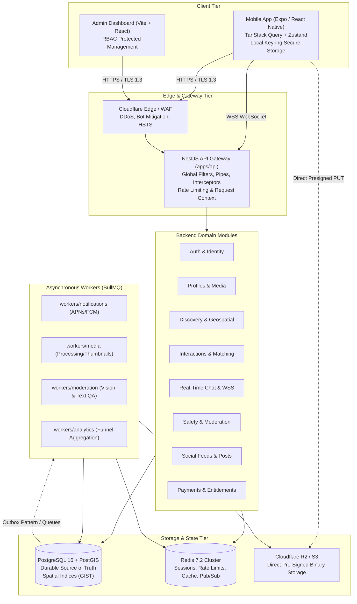
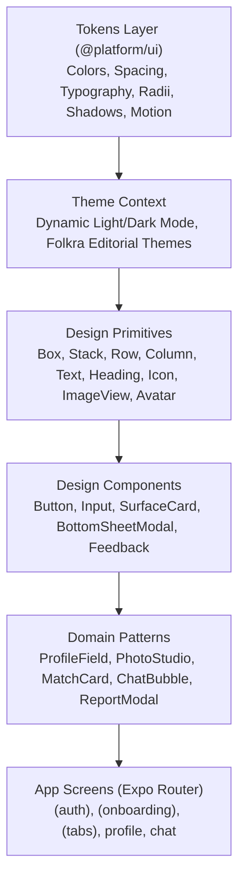
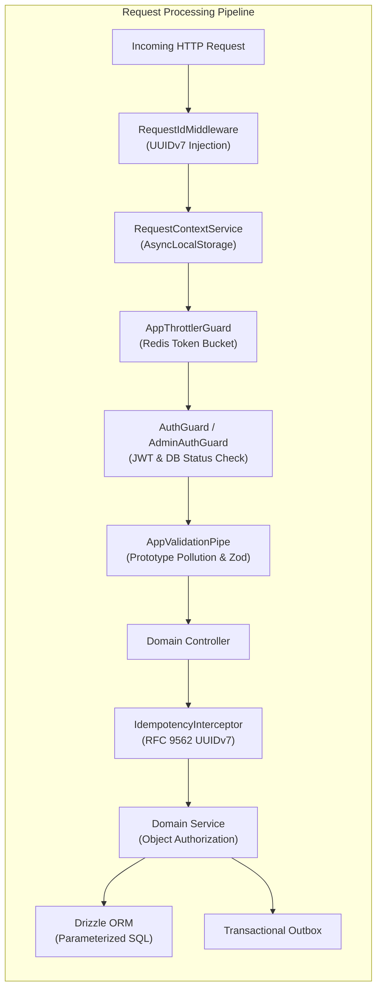

# Nazar System Architecture & Security Specification

This document provides a comprehensive, high-depth breakdown of the system architecture for the **Nazar** platform, spanning the mobile client frontend, backend services, shared contract packages, data topology, and defense-in-depth security model.

---

## 1. High-Level System Architecture & Topology

Nazar is architected as an authoritative **Modular Monolith** backend backed by a performant, cross-platform **React Native (Expo)** client and decoupled asynchronous background workers.



---

## 2. Monorepo Structure & Dependency Invariants

The codebase is organized as a Turborepo monorepo with strict package boundaries:

```text
nazar/
├── apps/
│   ├── mobile/             # React Native (Expo SDK 52, Expo Router v4)
│   ├── api/                # NestJS modular monolith backend
│   └── admin/              # React + Vite moderation & operations portal
├── packages/
│   ├── domain/             # Pure DDD entities, domain events, result types (zero framework dependencies)
│   ├── api-contracts/      # HTTP/WS DTOs, endpoint schemas, response envelopes
│   ├── validation/         # Zod schemas matching contracts and environment variables
│   ├── config/             # Type-safe environment loaders (ClientEnv vs ServerEnv)
│   └── ui/                 # Cross-platform design tokens (colors, typography, spacing, motion)
├── workers/
│   ├── analytics/          # Metric ingestion and daily aggregation
│   ├── media/              # Image manipulation, watermarking, blurhashes
│   ├── moderation/         # Automated text toxicity & image safety analysis
│   └── notifications/      # Real-time APNs / FCM push notification fanout
└── docs/                   # Full architectural documentation, runbooks, and audit specifications
```

### Architectural Invariants:

1. **Zero Cross-Application Imports**: `apps/*` never import directly from other applications.
2. **Domain Purity**: `@platform/domain` has zero dependencies on NestJS, React, Express, or database drivers.
3. **Secret Hygiene**: Client applications (`apps/mobile`, `apps/admin`) only consume `@platform/config` client-safe schemas (`ClientEnv`). Server secrets are strictly forbidden from leaking to bundles.
4. **Backend Authoritative**: The client presentation layer is untrusted. Match determinations, subscription entitlements, and moderation sanctions are computed exclusively server-side.

---

## 3. Frontend Architecture (`apps/mobile`)

The mobile client is engineered with React Native, Expo, and TypeScript using a layered component architecture.



### Key Frontend Subsystems:

1. **Routing & Navigation (`app/`)**:
   - File-based routing via `expo-router` v4.
   - Screen groups: `(auth)` (phone OTP, passkeys, legal consent), `(onboarding)` (intro, profile setup, photos, interests, prompts, preview), `(tabs)` (discover, matches, messages, profile).

2. **State Management**:
   - **Server State**: Managed via `@tanstack/react-query` with optimistic updates, cache invalidation, and automated retry backoffs.
   - **Client/Session State**: Managed via lightweight `zustand` stores (`useAuthStore`, `useOnboardingStore`, `useSocialStore`). Sensitive auth tokens are securely stored in the iOS Keychain / Android Keystore.

3. **In-Tree Modal Engine (`SmoothBottomSheetModal`)**:
   - Offers dual presentation modes: native `<Modal>` (`RCTModalHostViewController`) or in-tree overlay (`useNativeModal={false}`).
   - The in-tree mode avoids iOS UIKit presentation collisions when invoking native system sheets (`PHPickerViewController`, camera controllers), preventing frozen view hierarchies.

4. **Editorial Photo Studio**:
   - Integrated client-side processing using `expo-image-manipulator`.
   - Real-time photo filters (Portra 400, Golden Hour, Editorial Noir), interactive 4:5 cropping viewfinder, rotation, and aspect ratio normalization.

5. **Accessibility & Responsive Polish**:
   - Minimum 44x44pt touch targets on all interactive elements.
   - Dynamic scale adaptations using `useResponsiveLayout` for devices ranging from compact iPhone SE to large Pro Max displays.

---

## 4. Backend Architecture (`apps/api`)

The backend is constructed as an enterprise **Modular Monolith** in NestJS with modular vertical slices.



### Core Backend Modules:

| Module                   | Primary Responsibilities                                                                                               |
| :----------------------- | :--------------------------------------------------------------------------------------------------------------------- |
| **`AuthModule`**         | Passwordless phone OTP, Apple & Google OIDC, WebAuthn Passkeys, rotating refresh token lifecycle, device registration. |
| **`ProfilesModule`**     | Profile CRUD, lifestyle & religion metadata, prompts, media references, smart photo ordering.                          |
| **`DiscoveryModule`**    | Spatial discovery algorithms, PostGIS radius filtering, age/intentions preferences, card stack generation.             |
| **`InteractionsModule`** | Swipes (like, pass, superlike), mutual match detection, undo interaction logic, daily swipe quotas.                    |
| **`MatchesModule`**      | Mutual match state machine, active conversation initialization, unmatching, match expiration.                          |
| **`ChatModule`**         | Real-time chat via WebSockets, message delivery/read receipts, typing indicators, media message references.            |
| **`SafetyModule`**       | User reporting, blocking, safety center notifications, photo verification workflows, account suspension.               |
| **`PaymentsModule`**     | Subscription tiers, consumable boosts/superlikes, Apple App Store & Google Play webhook ingestion.                     |

---

## 5. Data & Storage Architecture

### 1. PostgreSQL 16 + PostGIS (Source of Truth)

- **Primary Keys**: RFC 9562 **UUIDv7** across all transactional tables. Provides time-sortable 128-bit identifiers that prevent B-Tree index fragmentation while enabling client-side generation without ID collisions.
- **Geospatial Discovery**:
  - Location stored as `geography(Point, 4326)`.
  - Spatial `GIST` indices applied to coordinates.
  - Queries execute spherical distance evaluation (`ST_DWithin`, `ST_Distance`) for boundary-accurate candidate selection.
- **ORM & Migrations**: Drizzle ORM ensures type-safe schema definitions, compile-time query validation, and strict parameterization.

### 2. Redis 7.2 (Ephemeral State & Caching)

- Session tracking and active connection registry.
- Sliding-window and token-bucket rate limiting via `@nestjs/throttler`.
- Real-time Pub/Sub broker for multi-instance WebSocket message broadcast.
- Transient candidate feed caches and user presence status.

### 3. Cloudflare R2 / S3 (Media Storage)

- **Zero Binary Proxying**: The API server never buffers or streams heavy image/video files.
- **Presigned Upload Flow**:
  1. Client requests a signed URL: `POST /v1/profiles/media/presign-upload`.
  2. Server validates user quotas, generates a UUIDv7 object path, and returns a signed `PUT` URL expiring in 15 minutes.
  3. Client uploads raw binary directly to R2.
  4. Client confirms upload: `POST /v1/profiles/media/confirm`.
  5. Server schedules an asynchronous processing job via BullMQ.

---

## 6. Comprehensive Security Architecture

Nazar implements a **defense-in-depth security model** protecting all architectural tiers:

```mermaid
flowchart TD
    subgraph S1["1. Network & Edge Security"]
        E1["Cloudflare WAF: DDoS protection, bot challenge"]
        E2["TLS 1.3 encryption & HSTS Preloading"]
        E3["Helmet security headers: nosniff, DENY framing, CORP/COOP"]
        E4["CORS: Strict origin reflection, zero wildcard credentials"]
    end

    subgraph S2["2. Authentication & Session Security"]
        A1["Dual-Token Model: 15-min JWT + 30-day rotating refresh token"]
        A2["Token Replay Protection: Token family revocation on reuse"]
        A3["SHA-256 hashed refresh tokens in PostgreSQL"]
        A4["Hardware Keychain / Keystore client credential binding"]
    end

    subgraph S3["3. Gateway & Request Sanitation"]
        G1["AppValidationPipe: Deep prototype pollution check (__proto__, constructor)"]
        G2["Zod Schema strictness: Strips unrecognized payloads"]
        G3["GlobalExceptionFilter: Sanitized envelopes, zero stack traces in production"]
        G4["Multi-tier rate limiting by IP, User ID, and Route Category"]
    end

    subgraph S4["4. Authorization & Application Logic"]
        L1["BOLA / IDOR Defense: Explicit ownership checks on every entity"]
        L2["Idempotency Keys (UUIDv7) to prevent replay/duplicate actions"]
        L3["Parameterized SQL via Drizzle ORM: Zero SQL injection"]
        L4["EventGovernanceService: Scrubs PII and secrets from event streams"]
    end

    subgraph S5["5. Audit & Compliance"]
        C1["Immutable security audit logs: security_events & admin_audit_logs"]
        C2["PII Redaction in structured JSON logs (password, token, otp, secret)"]
        C3["Least-privilege database role credentials"]
    end

    S1 --> S2 --> S3 --> S4 --> S5
```



### Detailed Security Controls:

### 1. Dual-Token Architecture & Replay Protection

- **Access Tokens**: Short-lived (15 minutes), stateless HMAC-SHA256 JWTs containing `sub` (User ID), `sid` (Session ID), and `dev` (Device ID).
- **Refresh Tokens**: Cryptographically random 32-byte hex strings with a 30-day validity window.
- **Cryptographic Rotation**:
  - The database stores only the `SHA-256` hash of the refresh token.
  - On `/v1/auth/refresh`, the presented token hash is checked against the active session.
  - If valid: the old hash is moved to `session_token_history`, a new token is generated, and the session is updated.
  - **Replay Detection**: If a hash is found in `session_token_history` (i.e. already used), an attacker or intercepted client is attempting a replay. The server **immediately revokes the entire session family**, logs a `CRITICAL` severity event in `security_events`, and terminates the connection with `401 TOKEN_REPLAY_DETECTED`.

### 2. Broken Object-Level Authorization (BOLA / IDOR) Defense

- Every service operation explicitly validates that the authenticated principal has rights to the affected resource:
  - `userId === entity.userId` on profile edits, photo uploads, preferences, account settings.
  - Conversation participants validated against `matches` membership before chat access.
  - Administrative endpoints require verified `AdminUser` status and granular permission bitmasks (`AdminPermissionsGuard`).

### 3. Prototype Pollution & Input Validation

- `AppValidationPipe` inspects all incoming JSON payloads before execution. It scans keys recursively for `__proto__`, `constructor`, and `prototype`, rejecting polluted payloads with `400 BAD_REQUEST`.
- Payload structures are strictly parsed against Zod schemas from `@platform/validation`, stripping extraneous keys.

### 4. Idempotency & Replay Guarding

- Critical state mutations (`POST /v1/interactions/swipe`, `POST /v1/chat/messages`, `POST /v1/billing/purchase`) require an `Idempotency-Key` header with an RFC 9562 UUIDv7.
- `IdempotencyInterceptor` tracks execution state in Redis/PostgreSQL (`STARTED`, `COMPLETED`, `FAILED`). Repeated requests return the cached response with `x-idempotent-replayed: true`, preventing double-billing or duplicate swipe deductions.

### 5. Sensitive Data Redaction & Logging

- `AppLoggerService` outputs structured JSON logs.
- Automatic recursive redaction scrubs sensitive keys: `password`, `token`, `authorization`, `secret`, `otp`, `cookie`, `cvv`, and cardholder data before outputting to stdout or cloud log aggregators.
