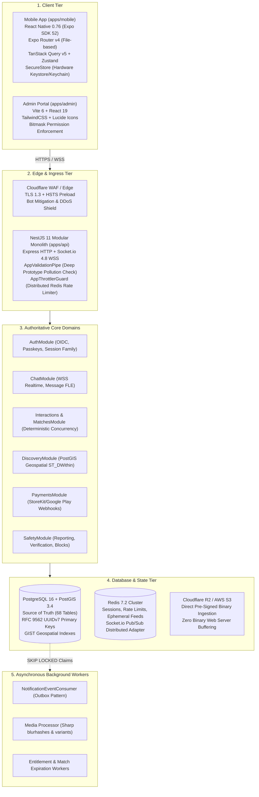
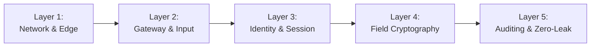
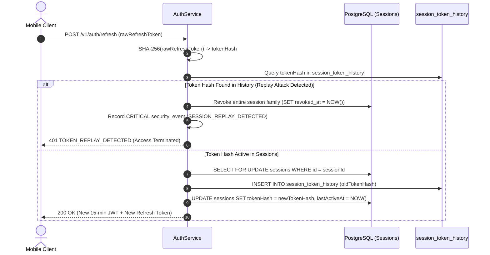
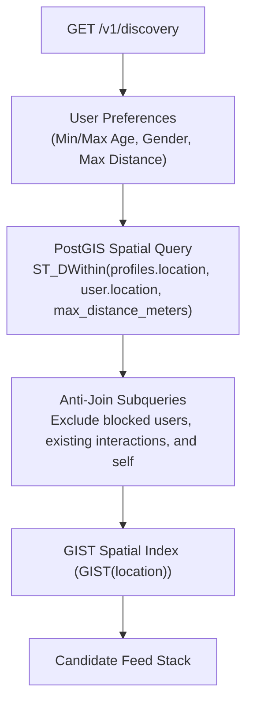

# Nazar Technical Specification: Security Architecture & Database Systems

This document details the complete technical stack, engineering methodologies, data topology, and defense-in-depth security model implemented across **Nazar**, designed to support **10+ million concurrent users** with Tier-1 enterprise and military-grade resilience.

---

## 1. Complete Technical Stack Breakdown

The platform is designed around strict clean-architecture separation, zero cross-boundary pollution, and deterministic backend authority:



### Stack Components Matrix

| Layer                         | Technologies & Libraries                                                         | Primary Architectural Role                                                      |
| :---------------------------- | :------------------------------------------------------------------------------- | :------------------------------------------------------------------------------ |
| **Backend Runtime**           | Node.js v24 (LTS), TypeScript 5.7                                                | High-throughput asynchronous event loop, strict typing.                         |
| **API Framework**             | NestJS 11, Express, `@nestjs/websockets`                                         | Modular monolith architecture, dependency injection, lifecycle management.      |
| **Real-Time Communication**   | Socket.io 4.8, Redis Adapter (`@socket.io/redis-adapter`)                        | Multi-instance bidirectional stateful WebSockets for messaging and presence.    |
| **Database & ORM**            | PostgreSQL 16, PostGIS 3.4, Drizzle ORM 0.45, `pg` 8.23                          | Compile-time type-safe queries, spatial GIS indexing, parameterized SQL.        |
| **In-Memory Cache & Broker**  | Redis 7.2 Alpine, `@nestjs/throttler`                                            | Token bucket/sliding-window rate limiting, distributed session cache.           |
| **Binary Object Storage**     | AWS S3 SDK (`@aws-sdk/client-s3`), Cloudflare R2                                 | Direct-to-bucket pre-signed PUT/GET; server never proxies media bytes.          |
| **Authentication & Identity** | OIDC (Apple/Google), WebAuthn Passkeys (`@simplewebauthn`), Firebase Admin       | Passwordless SMS/Email OTP, biometric passkeys, hardware credential binding.    |
| **Cryptographic Primitives**  | Node.js `node:crypto` (`aes-256-gcm`, `hkdfSync`, `timingSafeEqual`)             | Military-grade authenticated encryption at rest, blind indexing, token hashing. |
| **Domain & Contracts**        | Turborepo, `@platform/api-contracts`, `@platform/domain`, `@platform/validation` | Unified Zod schemas, zero contract drift across client and server.              |

---

## 2. Security Architecture: Defense-in-Depth Breakdown

Nazar enforces a five-layer defense model built to meet Tier-1 e-commerce/financial-grade standards (similar to Amazon/Flipkart):



### Layer 1: Network & Edge Armor

1. **Strict Transport Security (HSTS)**: Preloaded with `max-age=31536000; includeSubDomains; preload` ensuring downgrade attacks (SSL-stripping) fail immediately.
2. **Helmet 8.0 Defensive Headers**:
   - `X-Content-Type-Options: nosniff` (MIME confusion prevention)
   - `X-Frame-Options: DENY` (Anti-clickjacking)
   - Strict Content Security Policy (CSP) and Cross-Origin Resource Policy (CORP).
3. **CORS Hardening**: Strict origin reflection validating against configured production domains; wildcard credentials (`*` with `credentials: true`) are forbidden.

### Layer 2: Gateway & Input Sanitation

1. **Deep Prototype Pollution Shield**:
   [`AppValidationPipe`](file:///Users/subhamdas/Documents/nazar-main/apps/api/src/common/pipes/app-validation.pipe.ts) recursively inspects every incoming JSON payload, immediately rejecting keys containing `__proto__`, `constructor`, or `prototype` with `400 BAD_REQUEST`.
2. **Strict Zod Parsing & Stripping**:
   All endpoints deserialize payloads through `@platform/validation` Zod schemas with `strip()` mode enabled—unrecognized or injected fields are discarded before reaching controllers.
3. **Multi-Tier Rate Limiting**:
   Using `@nestjs/throttler` backed by Redis sliding windows, rate limits are enforced by IP, authenticated user ID, and sensitive action type (e.g. 5 OTP attempts per 5 minutes; 100 API requests per minute).

### Layer 3: Identity & Session Lifecycle Security

The platform uses a Dual-Token Model augmented with cryptographic rotation and session family tracking:



- **Short-Lived Access Tokens**: 15-minute stateless JWTs signed with HMAC-SHA256 containing `sub` (User ID), `sid` (Session ID), and `dev` (Device ID).
- **Opaque Refresh Tokens**: Cryptographically random 32-byte hex strings (`crypto.randomBytes(32)`).
- **Zero Plaintext Token Storage**: Only the `SHA-256` hash is stored in the database.
- **Row-Locked Atomic Token Rotation**: [`SessionRepository.rotateSessionToken`](file:///Users/subhamdas/Documents/nazar-main/apps/api/src/modules/auth/repositories/session.repository.ts#L87-L148) locks the session row via `SELECT ... FOR UPDATE`, guaranteeing that concurrent requests cannot rotate or reuse a token concurrently.
- **Automatic Family Revocation on Replay**: If an attacker intercepts and presents an already-rotated token hash found in `session_token_history`, the backend terminates the entire session family, invalidates all child sessions, and raises a `CRITICAL` telemetry event.

### Layer 4: Field-Level Authenticated Encryption (AES-256-GCM)

To guarantee private chat security (even in the event of an unauthorized database snapshot leak or physical compromise), messages use Field-Level Encryption (FLE) at rest:

```text
Database Storage Format:
enc:v1:<12-byte-IV-hex>:<16-byte-Tag-hex>:<Ciphertext-hex>
```

- **Cryptographic Key Derivation**:
  In [`FieldEncryptionService`](file:///Users/subhamdas/Documents/nazar-main/apps/api/src/common/crypto/field-encryption.service.ts), a 256-bit key is derived using **HKDF-SHA256** from master server secrets with domain-separated salt (`nazar:field-encryption:salt:v1`) and context info (`nazar:aes-256-gcm:message-envelope:v1`).
- **Authenticated Encryption with Associated Data (AEAD)**:
  Uses `aes-256-gcm` with a unique 96-bit random IV (`crypto.randomBytes(12)`) and a 128-bit authentication tag per message.
- **Fail-Closed Integrity**:
  If ciphertext is tampered with or modified in the database by even 1 bit, decipher verification fails and the service aborts without decrypting.
- **Transparent Repository Lifecycle**:
  [`MessagesRepository`](file:///Users/subhamdas/Documents/nazar-main/apps/api/src/modules/chat/repositories/messages.repository.ts) encrypts plaintext on insert and decrypts rows transparently when fetched for authorized participants. Plaintext never touches PostgreSQL storage.

### Layer 5: Information Leak-Proofing & Auditing

1. **Structured Log Sanitization**:
   [`AppLoggerService`](file:///Users/subhamdas/Documents/nazar-main/apps/api/src/common/logging/app-logger.service.ts) recursively sanitizes JSON logs, scrubbing `password`, `token`, `secret`, `otp`, `authorization`, `creditcard`, `cvv`, `rawtoken`, and connection URIs (`postgres://...`).
2. **Global Exception Masking**:
   [`GlobalExceptionFilter`](file:///Users/subhamdas/Documents/nazar-main/apps/api/src/common/filters/global-exception.filter.ts) strips raw SQL exceptions, table names, constraint violations, and stack traces before returning standard `ApiFailureEnvelope` responses.
3. **BOLA / IDOR Protection**:
   Every database read and mutation strictly asserts resource ownership (`userId === entity.userId` or mutual match participation).

---

## 3. Database Architecture & Concurrency Control (10M+ Scale)

### Data Topology & Primary Keys

- **RFC 9562 UUIDv7 Throughout**:
  All 68 tables use 128-bit UUIDv7 identifiers. UUIDv7 combines a 48-bit millisecond timestamp with 74 bits of cryptographically random data.
  - _Why this scales to 10M+ users_: Standard UUIDv4 causes random insertion patterns, triggering catastrophic PostgreSQL B-Tree page splits and cache churn. UUIDv7 is monotonically time-ordered, achieving index insert speeds comparable to auto-incrementing integers while preserving client-side generation capability without collisions.

### Concurrency & Transaction Serialization

At 10M+ scale, simultaneous reciprocal actions (e.g. User A swipes right on User B while User B swipes right on User A at the exact same millisecond) must never create duplicate matches or deadlock the database:

```mermaid
sequenceDiagram
    autonumber
    actor Alice
    actor Bob
    participant DB as PostgreSQL Transaction

    Note over Alice,Bob: Normalized Pair: userAId < userBId
    par Simultaneous Likes
        Alice->>DB: pg_advisory_xact_lock(hashtext('match:' || userAId || ':' || userBId))
    and
        Bob->>DB: pg_advisory_xact_lock(hashtext('match:' || userAId || ':' || userBId))
    end
    Note over DB: Lock granted to Alice; Bob waits deterministically
    DB->>DB: Alice: Upsert interaction -> No reciprocal like yet -> Commit & Release
    Note over DB: Lock granted to Bob
    DB->>DB: Bob: Upsert interaction -> Detects Alice's LIKE -> Creates exactly 1 Match -> Commit & Release
```

1. **Deterministic User Normalization**:
   [`normalizeUserPair(actorUserId, targetUserId)`](file:///Users/subhamdas/Documents/nazar-main/apps/api/src/modules/matches/domain/match.utils.ts) sorts user IDs deterministically (`userAId < userBId`). This eliminates AB-BA deadlock cycles across concurrent operations.
2. **Transaction-Scoped Advisory Locks**:
   In [`InteractionsService.like`](file:///Users/subhamdas/Documents/nazar-main/apps/api/src/modules/interactions/services/interactions.service.ts#L116-L150), transactions execute:
   ```sql
   SELECT pg_advisory_xact_lock(hashtext('match:' || userAId || ':' || userBId));
   ```
   This serializes mutual match creation in memory before row writing, guaranteeing zero duplicate match records.
3. **Transactional Outbox Pattern**:
   State transitions (e.g., match created, message sent, subscription verified) write a corresponding domain event into the `outbox_events` table within the same ACID transaction.
   - Background workers poll using `SELECT ... FOR UPDATE SKIP LOCKED` to achieve linear horizontal worker scalability without lock contention.
4. **Connection Pool Configuration (`pg.Pool`)**:
   - `keepAlive: true` and `keepAliveInitialDelayMillis: 10000` to prevent cloud firewall/NAT socket drops.
   - `statement_timeout: 10000` and `query_timeout: 10000` preventing long-running queries from starving connection pools.
   - `pool.on('error')` handling that catches transient connection reset errors without terminating cluster instances.

---

## 4. Geospatial Discovery Engine (PostGIS)

Candidate discovery for 10M+ users requires sub-50ms query latency across global coordinates:



- Coordinates stored as spherical `geography(Point, 4326)`.
- Indexed using PostgreSQL `GIST` spatial indices.
- Spherical distance calculations (`ST_DWithin`, `ST_Distance`) evaluate true ellipsoidal boundaries rather than inaccurate Euclidean projections.

---

## 5. Security & Architectural Verification Summary

| Security Feature                 | Implementation Mechanism                                  | Verification Suite                                                                                                                                                                                                             |
| :------------------------------- | :-------------------------------------------------------- | :----------------------------------------------------------------------------------------------------------------------------------------------------------------------------------------------------------------------------- |
| **Field-Level Encryption**       | AES-256-GCM + HKDF-SHA256 Envelope Cryptography           | [`crypto-field-encryption.test.ts`](file:///Users/subhamdas/Documents/nazar-main/apps/api/tests/crypto-field-encryption.test.ts)                                                                                               |
| **Mutual Swipe Concurrency**     | Normalized advisory locks + ACID transactions             | [`matches-concurrency.test.ts`](file:///Users/subhamdas/Documents/nazar-main/apps/api/tests/matches-concurrency.test.ts)                                                                                                       |
| **Session Replay Defense**       | `session_token_history` + Row-level lock rotation         | [`auth-session.test.ts`](file:///Users/subhamdas/Documents/nazar-main/apps/api/tests/auth-session.test.ts), [`auth-concurrency.test.ts`](file:///Users/subhamdas/Documents/nazar-main/apps/api/tests/auth-concurrency.test.ts) |
| **BOLA / IDOR Verification**     | Object authorization & match member verification          | [`security-hardening.test.ts`](file:///Users/subhamdas/Documents/nazar-main/apps/api/tests/security-hardening.test.ts)                                                                                                         |
| **Information Leak Shield**      | Recursive log redaction + exception envelope sanitization | [`error-and-envelope.test.ts`](file:///Users/subhamdas/Documents/nazar-main/apps/api/tests/error-and-envelope.test.ts)                                                                                                         |
| **Worker Processing Throughput** | Outbox pattern with `SKIP LOCKED` batch processing        | [`worker-throughput.perf.test.ts`](file:///Users/subhamdas/Documents/nazar-main/apps/api/tests/perf/worker-throughput.perf.test.ts)                                                                                            |
