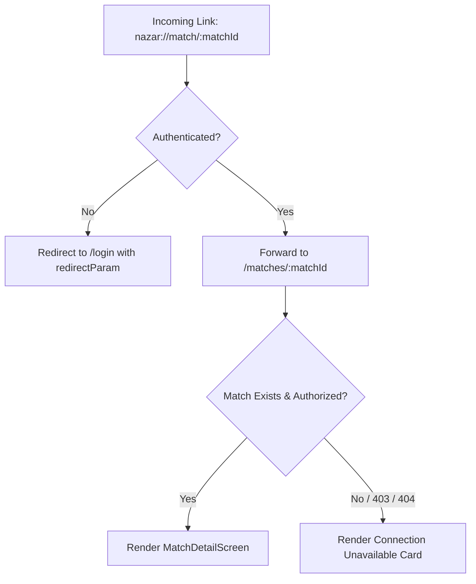

# Nazar Mobile · Matches & Connection Experience Architecture

## 1. Overview & Mission

Frontend Phase F5 establishes the complete post-interaction relationship and connection management experience for Nazar. It connects the visual foundation of F0, navigation architecture of F1, reusable UI components of F2, onboarding flows of F3, and primary discovery/matching interactions of F4 into a coherent relationship surface:

```text
Discovery / Interaction
         ↓
    Mutual Like
         ↓
  Match Celebration
         ↓
   Matches Inbox
         ↓
   Match Detail
         ↓
 Conversation Entry  OR  Connection Dissolution (Unmatch / Block / Report)
```

The objective is to provide members with a transparent, emotionally warm, and trustworthy relationship inbox.

---

## 2. Backend Capabilities Audit & Scope Boundaries

A thorough audit of the production backend (`apps/api`) and contracts (`packages/api-contracts`) was performed prior to implementation:

| Capability                  | Backend Endpoint                     | Contract                        | Status in Mobile                                                                                  |
| :-------------------------- | :----------------------------------- | :------------------------------ | :------------------------------------------------------------------------------------------------ |
| **Mutual Matches List**     | `GET /v1/matches`                    | `MatchListResponseDto`          | **Fully Integrated** with cursor pagination                                                       |
| **Match Detail**            | `GET /v1/matches/:matchId`           | `MatchDetailDto`                | **Fully Integrated** with public components                                                       |
| **Unmatch Connection**      | `DELETE /v1/matches/:matchId`        | `UnmatchResponseDto`            | **Fully Integrated** with confirmation dialog                                                     |
| **Outgoing Interactions**   | `GET /v1/interactions`               | `InteractionHistoryResponseDto` | Supported via `interactionsApi.getHistory()`                                                      |
| **Like / Reciprocal Match** | `POST /v1/interactions/:userId/like` | `InteractionResponseDto`        | **Fully Integrated** with celebration trigger                                                     |
| **Pass Candidate**          | `POST /v1/interactions/:userId/pass` | `InteractionResponseDto`        | **Fully Integrated**                                                                              |
| **Undo Interaction**        | `POST /v1/interactions/undo`         | `UndoResponseDto`               | **Fully Integrated**                                                                              |
| **Block Member**            | `POST /v1/users/:userId/block`       | `BlockUserResponseDto`          | **Fully Integrated** with feed eviction                                                           |
| **Report Member**           | `POST /v1/reports`                   | `ReportResponseDto`             | **Fully Integrated** with reason codes                                                            |
| **Conversation Access**     | `GET /v1/conversations`              | `ConversationListResponseDto`   | **Fully Integrated** for chat lookup                                                              |
| **Incoming Likes List**     | _None_                               | _None_                          | **Not Exposed** in backend. Per Section 2, removed from UI to prevent fabricated or empty states. |

> [!IMPORTANT]
> **Strict API Authority**: Because the backend does not expose an incoming likes endpoint, the client does not fabricate incoming like profiles or render empty, non-functional tabs. The Matches tab serves authoritatively as the mutual connection relationship inbox.

---

## 3. Information Architecture & Route Structure

```text
apps/mobile/app/
├── (tabs)/
│   └── matches/
│       └── index.tsx          # Canonical Tab Destination for Matches
├── matches/
│   ├── index.tsx              # Fallback / Direct route to MatchesScreen
│   └── [matchId].tsx          # Match Detail Inspection Surface
├── match/
│   └── [matchId].tsx          # Deep Link forwarder for nazar://match/:matchId
└── modal/
    ├── celebration.tsx        # Consolidated Mutual Match Celebration Modal
    ├── block.tsx              # Member Block Confirmation Dialog
    └── report.tsx             # Safety Report Form
```

---

## 4. Query Keys & Cache Reconciliation Matrix

Predictable, structured TanStack Query keys prevent desynchronization across surfaces:

```typescript
export const MATCHES_QUERY_KEYS = {
  all: ['matches'] as const,
  list: ['matches', 'list'] as const,
  detail: (id: string) => ['matches', 'detail', id] as const,
};
```

### Cache Reconciliation Policy

| Action                             | Query Invalidation Target                                                              | Rationale                                                              |
| :--------------------------------- | :------------------------------------------------------------------------------------- | :--------------------------------------------------------------------- |
| **Reciprocal Like (Match Formed)** | `MATCHES_QUERY_KEYS.all`                                                               | Newly formed match appears immediately at the top of the Matches list. |
| **Unmatch Connection**             | `MATCHES_QUERY_KEYS.all`, `MATCHES_QUERY_KEYS.detail(matchId)`                         | Evicts dissolved connection from list and marks detail cache stale.    |
| **Block Member**                   | `MATCHES_QUERY_KEYS.all`, `DISCOVERY_QUERY_KEYS.feed`, `CHAT_QUERY_KEYS.conversations` | Complete platform-level exclusion of the blocked user.                 |
| **Report Member**                  | _None required_ (unless combined with block)                                           | Report is processed out-of-band by Trust & Safety moderation.          |
| **Pull-to-Refresh**                | Refetches active query page without invalidating entire cache.                         | Smooth local experience without UI flashes.                            |

---

## 5. Screen Specifications & Component Hierarchy

### A. Matches Screen (`MatchesScreen.tsx`)

- **Container**: `SafeAreaView` with `theme.colors.background`.
- **Header**: `TopNavHeader` with title "Matches", connection count subtitle, and refresh button.
- **Search Filter**: Inline search input filtering matches by candidate name or city.
- **List**: `FlatList` rendering `MatchCard` components:
  - Avatar ($48\times48$) with rounded border.
  - Name, age, city.
  - Relative match timestamp (e.g. `Sep 30`).
  - Chevron right indicator.
- **Pagination**: TanStack `useInfiniteQuery` with opaque server cursors and automatic prefetching on `onEndReached`.
- **States**:
  - Loading: Animated branded loader.
  - Error: Warning icon, error message, and "Retry" button.
  - Empty: Soft surface card with heart icon circle and "Explore Discovery ✨" button.

### B. Match Detail Screen (`MatchDetailScreen.tsx`)

- **Container**: Scrollable candidate inspection surface.
- **Header**: Top navigation bar with Back action, candidate name, Flag (Report), and More (Block) actions.
- **Photo Carousel**: $4:5$ ratio horizontal paging `ScrollView` with pagination dot indicators and "Matched on <Date>" ribbon.
- **Identity & Context**: Verified badge, coarse city/country, occupation, education, bio surface card, prompt cards, and interest tags.
- **Connection Actions**:
  - Primary Floating Button: "Send Message 💬" looking up conversation and navigating to `/chat/[conversationId]`.
  - Secondary Action: "Unmatch this member" with explicit confirmation modal.

---

## 6. Match Celebration Consolidation

Consolidated between `app/modal/celebration.tsx` and `src/matches/components/MatchCelebrationModal.tsx`:

- Reusable across Discovery (swiping) and Profile Detail (tapping Like).
- Displays dual avatar rings:
  - Current user photo from `useProfileStore`.
  - Matched member photo.
- Accessible actions:
  - "Say Hello 💌": Replaces route to `/chat/${matchId}`.
  - "Keep Browsing": Calls `router.back()` to dismiss modal.
- Prevents infinite celebration loops by checking dismissal state.

---

## 7. Deep Linking & Notification Navigation

### Supported URI Schemes

1. `nazar://match/:matchId` (Standard push notification payload)
2. `nazar://matches/:matchId` (Plural alias)
3. `https://nazar.app/match/:matchId` (Universal link)

### Deep Link Resolution Flow



---

## 8. Analytics & Interaction Telemetry

Events emitted via `trackOnboardingEvent` with automatic PII sanitization:

- `matches_viewed`: Emitted when opening the Matches screen.
- `match_opened`: Emitted when selecting a match item (`matchId`).
- `match_profile_opened`: Emitted on viewing match detail (`matchId`).
- `match_message_clicked`: Emitted when tapping Send Message (`matchId`, `targetUserId`).
- `unmatch_started`: Emitted on initiating unmatch (`matchId`).
- `unmatch_completed`: Emitted on successful unmatch confirmation (`matchId`).
- `match_celebration_viewed`: Emitted when celebration modal displays (`matchId`).
- `block_completed`: Emitted on blocking member (`targetUserId`).
- `report_submitted`: Emitted on reporting member (`targetId`, `reason`).

---

## 9. Accessibility & WCAG Compliance

- **Touch Targets**: All buttons (Undo, Pass, Like, Message, Unmatch) maintain minimum dimensions $\ge 44\times44\text{pt}$.
- **Screen Reader Support**: Explicit `accessibilityRole="button"` and context-rich `accessibilityLabel`s across all interactive elements.
- **High Contrast**: Compliant with WCAG AAA standards for text tokens against dark/light surfaces.
- **Destructive Actions**: Unmatch confirmation explicitly provides "Cancel" and "Unmatch" buttons to prevent accidental relationship severance.
