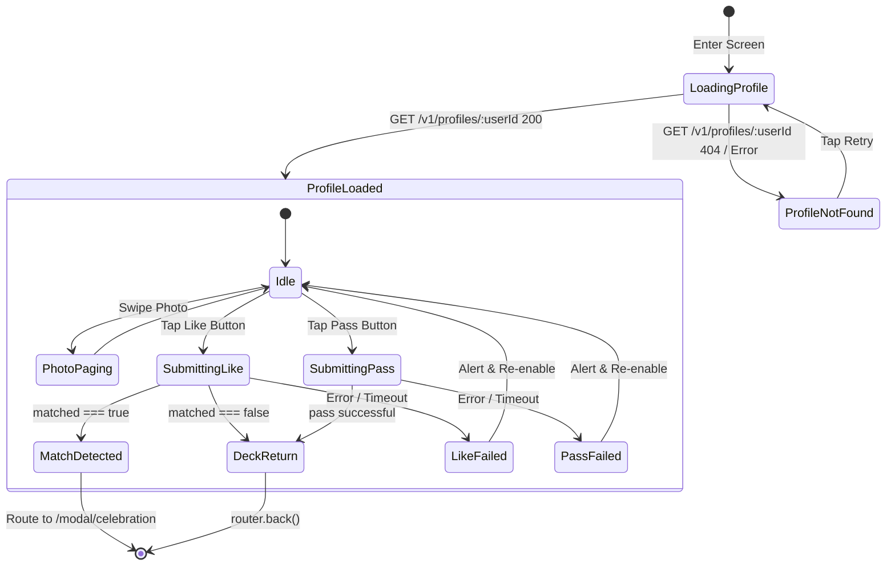

# Nazar Mobile · Profile Detail & Candidate Inspection Specification

## 1. Overview & Purpose

The Profile Detail screen (`/profile/[userId]`) is Nazar's dedicated high-fidelity candidate inspection surface. While the Discovery feed card provides an immediate snapshot designed for rapid evaluation, the Profile Detail view enables members to explore a candidate's full story: complete multi-photo media gallery, expressive prompt answers, detailed interests taxonomy, and professional background.

This document specifies the information architecture, API contracts, interaction flows, safety integration, and accessibility guidelines for the Profile Detail surface.

---

## 2. Route Architecture & Navigation Boundaries

### Route Path

```text
apps/mobile/app/profile/[userId].tsx
```

### Route Parameters

| Parameter | Type            | Required | Description                                             |
| :-------- | :-------------- | :------- | :------------------------------------------------------ |
| `userId`  | `string` (UUID) | Yes      | The canonical user ID of the candidate being inspected. |

### Navigation Ingress Points

1. **Discovery Feed**: Tapping on the active candidate card body or tapping the chevron/info button in the bottom action bar.
2. **Matches Grid**: Tapping on a matched member card from `/(tabs)/matches`.
3. **Explore / Recommendations**: Tapping on curated or community member cards.

### Navigation Egress Boundaries

1. **Back Navigation**: Left action button in `TopNavHeader` calls `router.back()`.
2. **Like Action**: Bottom floating action bar Like button triggers like mutation:
   - If mutual match (`matched === true`): transitions to `/modal/celebration?matchId=...`.
   - If non-match: calls `router.back()` to return to the active discovery deck.
3. **Pass Action**: Bottom floating action bar Pass button triggers pass mutation and calls `router.back()`.
4. **Safety Report**: Header right action flag button opens `/modal/report?targetId=${userId}`.
5. **Safety Block**: Header right action more button opens `/modal/block?targetUserId=${userId}`.

---

## 3. Data Dependencies & API Contracts

### Authoritative Backend Endpoint

```http
GET /v1/profiles/:userId
```

### Public Profile Contract (`PublicProfileResponse`)

```typescript
export interface PublicProfileResponse {
  readonly id: string;
  readonly userId?: string;
  readonly displayName: string;
  readonly age: number;
  readonly gender: Gender;
  readonly bio?: string | null;
  readonly occupation?: string | null;
  readonly education?: string | null;
  readonly city?: string | null;
  readonly countryCode?: string | null;
  readonly interests: readonly InterestItem[];
  readonly prompts: readonly PublicPromptItem[];
  readonly media: readonly PublicMediaItem[];
}
```

### Strict Privacy & Security Boundaries

- **No Exact Geolocation**: The backend strictly sanitizes location. The mobile client receives only coarse buckets (`city`, `countryCode`, or distance bucket string like `Within 5 km`). Raw latitude and longitude coordinates are **never** present in the payload.
- **No Direct Identifiers**: Email addresses, phone numbers, and full legal names are excluded from public profile responses.
- **Media CDN URLs**: All photo URLs reference pre-signed CDN endpoints with cache headers.

---

## 4. Visual Layout & Component Composition

```text
┌────────────────────────────────────────────────────────┐
│  ← [Display Name]                       [Flag] [More]  │  TopNavHeader
├────────────────────────────────────────────────────────┤
│ ┌────────────────────────────────────────────────────┐ │
│ │                                                    │ │
│ │               Photo Carousel (4:5)                 │ │  Horizontal Paging
│ │                                                    │ │  ScrollView
│ │                  ● ○ ○ ○                           │ │  Active Dots
│ └────────────────────────────────────────────────────┘ │
│                                                        │
│  Ananya, 26                         [Verified Badge]   │  Identity Row
│  📍 Bandra West, Mumbai                                │  Coarse Location
│  💼 Architect  ·  ✨ JJ College of Architecture        │  Background
│                                                        │
│ ┌────────────────────────────────────────────────────┐ │
│ │ About Me                                           │ │  SurfaceCard
│ │ Architect by weekday, classical vocalist by...     │ │  (Bio)
│ └────────────────────────────────────────────────────┘ │
│                                                        │
│ ┌────────────────────────────────────────────────────┐ │
│ │ MY IDEAL SUNDAY                                    │ │  Prompt Card 1
│ │ Filter coffee at Matunga followed by leisurely...  │ │
│ └────────────────────────────────────────────────────┘ │
│                                                        │
│  Interests & Passions                                  │
│  [Architecture] [Classical Music] [Filter Coffee]      │  Interest Chips
│                                                        │
├────────────────────────────────────────────────────────┤
│                 ( ✕ Pass )      ( 💕 Like )            │  Floating Action Bar
└────────────────────────────────────────────────────────┘
```

### Component Hierarchy

- `SafeAreaView` & `TopNavHeader`: Edge-to-edge container with back button and report/block actions.
- `ScrollView`: Smooth vertical scrolling for profile story with `showsVerticalScrollIndicator={false}`.
- `PhotoCarousel`: Horizontal `ScrollView` with `pagingEnabled` and dynamic active dot indicators.
- `IdentitySection`: Primary title heading with age and verified badge (`variant="success" icon="checkCircle"`).
- `SurfaceCard` (Bio): Soft-bordered card container highlighting candidate bio text.
- `PromptCard`: Saffron uppercase question label accompanied by comfortable body response typography.
- `InterestChips`: Rounded pill badges rendered with `colors.surfaceMuted` and subtle borders.
- `BottomActionBar`: Floating sticky footer housing accessible Pass ($60\times60$) and Like ($68\times68$) circle buttons.

---

## 5. Interaction State Machine



---

## 6. Safety & Moderation Flow

1. **Reporting (`/modal/report`)**:
   - Tapping the flag button navigates to the safety report modal passing `targetId=${userId}`.
   - User chooses from canonical `ReportReasonCode` values (`HARASSMENT`, `INAPPROPRIATE_CONTENT`, `FAKE_PROFILE`, `SPAM`, `SCAM_OR_FRAUD`, `MINOR_SAFETY_CONCERN`, `OTHER`).
   - Dispatches `POST /v1/reports` via `safetyApi.createReport`.
   - Displays confidential confirmation alert and navigates back.

2. **Blocking (`/modal/block`)**:
   - Tapping the more button navigates to the destructive block dialog passing `targetUserId=${userId}`.
   - User confirms account block.
   - Dispatches `POST /v1/users/:userId/block` via `safetyApi.blockUser`.
   - Invalidates `DISCOVERY_QUERY_KEYS.feed` in TanStack Query cache.
   - Instantly evicts candidate from user views and redirects back to discovery deck.

---

## 7. Accessibility & Testability

- **Screen Readers**:
  - Top header provides clear title and explicit `accessibilityLabel` for Report and Block buttons.
  - Carousel images declare `accessibilityLabel={`${profile.displayName}'s photo ${idx + 1}`}`.
  - Action buttons declare explicit `accessibilityRole="button"` and `accessibilityLabel={`Like ${profile.displayName}`}`.
- **High Contrast**:
  - All text styles strictly reference semantic tokens (`colors.textPrimary`, `colors.textSecondary`, `colors.accent`).
  - Action buttons feature clear visual borders and elevation shadows for thumb affordance.
- **Automated Test Identifiers (`testID`)**:
  - `profile-detail-like-btn`: Like circle button.
  - `profile-detail-pass-btn`: Pass circle button.
