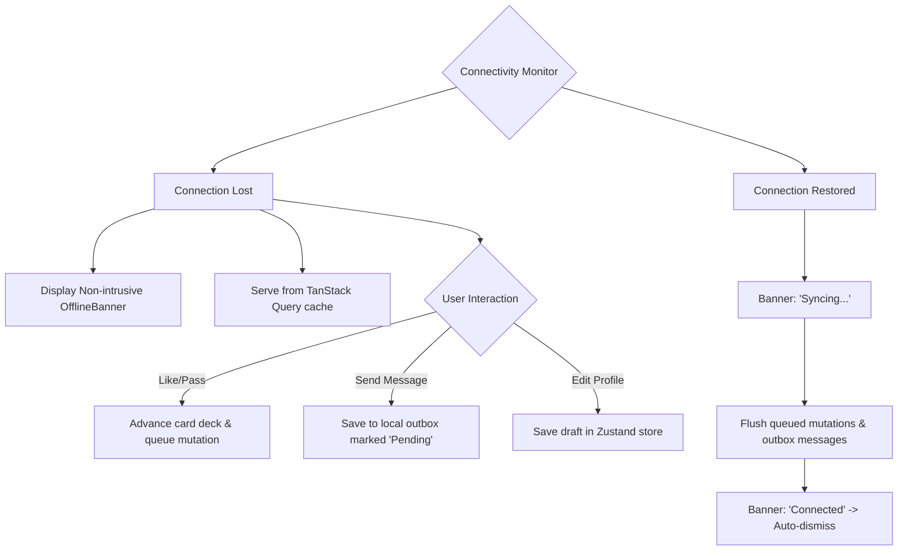

# Nazar Mobile User Flows & Interaction Models (F1)

**Version:** 1.0.0 (Frontend F1)  
**Status:** Canonical Flow Specification  
**Governing Principle:** People-first, dignified connection, clear hierarchy, deterministic exit conditions.

---

## 1. New User Onboarding Flow

Designed to collect vital matching parameters progressively without frontloading cognitive fatigue or permission requests.

```mermaid
flowchart TD
    Launch[App Cold Launch] --> RootCheck{Token in Storage?}
    RootCheck -- No --> Welcome[/(auth)/welcome]
    Welcome --> TapGetStarted[Tap 'Get Started']
    TapGetStarted --> LoginOptions[/(auth)/login]
    LoginOptions --> EnterPhone[Enter Phone Number / Email]
    EnterPhone --> RequestOtp[POST /v1/auth/otp/request]
    RequestOtp --> OtpScreen[/(auth)/otp]
    OtpScreen --> EnterCode[Enter 6-digit SMS Code]
    EnterCode --> VerifyOtp[POST /v1/auth/otp/verify]
    VerifyOtp --> CheckNew{Profile Exists?}
    CheckNew -- No --> ProfileSetup[/(onboarding)/profile-setup]
    ProfileSetup --> EnterBasic[Name, DOB 18+, Gender, Intent]
    EnterBasic --> SaveBasic[PUT /v1/profiles/me]
    SaveBasic --> PhotoUpload[/(onboarding)/photos]
    PhotoUpload --> UploadPhotos[Upload min 2 photos]
    UploadPhotos --> Interests[/(onboarding)/interests]
    Interests --> PickTags[Select 5+ Lifestyle/Cultural Tags]
    PickTags --> Prompts[/(onboarding)/prompts]
    Prompts --> AnswerPrompts[Select & Answer 1-3 Prompts]
    AnswerPrompts --> ContextPerms[/(onboarding)/permissions]
    ContextPerms --> GrantPerms[Location & Notification Contextual Prompts]
    GrantPerms --> ActivateProfile[POST /v1/profiles/me/activate]
    ActivateProfile --> Discovery[/(tabs)/discovery]
```

### Contextual Permission Principles
* **Location:** Requested on the permissions screen with clear copy: *"Nazar needs location access to find matches and community mixers near your neighborhood. Your exact coordinates are never revealed."*
* **Camera / Photos:** Requested only when the user taps an empty photo slot on `/(onboarding)/photos`.
* **Push Notifications:** Requested after profile activation so the user understands the value: *"Get notified immediately when someone likes you or messages your profile."*

---

## 2. Returning User Session Flow

```mermaid
flowchart TD
    Launch[App Launch] --> CheckStorage{Tokens in Storage?}
    CheckStorage -- Yes --> Validate[Validate Access Token]
    Validate -- Valid --> Discovery[/(tabs)/discovery]
    Validate -- Expired --> SingleFlight[Execute Single-Flight Refresh]
    SingleFlight -- Success --> SaveTokens[Save New Access/Refresh Tokens]
    SaveTokens --> Discovery
    SingleFlight -- Failed/Revoked --> ClearStorage[Clear Storage]
    ClearStorage --> Welcome[/(auth)/welcome]
    CheckStorage -- No --> Welcome
```

---

## 3. Discovery & Evaluation Flow

```mermaid
flowchart TD
    Feed[/(tabs)/discovery] --> ViewCard[View ProfileCard]
    ViewCard --> TapPhoto[Tap Left/Right to browse photos]
    ViewCard --> TapCard[Tap ProfileCard to open detail]
    TapCard --> FullDetail[/profile/:userId]
    FullDetail --> ReadBio[Read Bio, Cultural Interests & Prompts]
    
    FullDetail --> Decision{User Choice}
    ViewCard --> Decision
    
    Decision -- Pass --> CallPass[POST /v1/interactions/:id/pass]
    CallPass --> NextCard[Animate out & load next candidate]
    
    Decision -- Like --> CallLike[POST /v1/interactions/:id/like]
    CallLike --> CheckMatch{Matched == true?}
    CheckMatch -- No --> NextCard
    CheckMatch -- Yes --> OpenCelebration[/modal/celebration]
```

---

## 4. Match & Celebration Flow

Mutual likes trigger an immediate emotional celebration modal without locking the user in a dead-end loop.

```mermaid
flowchart TD
    LikeSuccess[Mutual Like Confirmed] --> CelebrationModal[/modal/celebration]
    CelebrationModal --> ShowAvatars[Display Both Avatars & Names]
    CelebrationModal --> ActionChoice{User Selection}
    
    ActionChoice -- 'Say Hello' --> StartChat[/chat/:conversationId]
    ActionChoice -- 'Keep Browsing' --> DismissModal[Dismiss Modal]
    ActionChoice -- 'Close' --> DismissModal
    
    DismissModal --> ReturnDiscovery[/(tabs)/discovery]
    StartChat --> MessageInput[Focus Message Input]
```

---

## 5. Messaging & Realtime Chat Flow

```mermaid
flowchart TD
    EntryChoice{Entry Point} --> MatchDetail[/matches/:matchId]
    EntryChoice --> ConvList[/(tabs)/messages]
    EntryChoice --> DeepLink[nazar://chat/:conversationId]
    
    MatchDetail -- 'Chat' --> OpenChat[/chat/:conversationId]
    ConvList -- Tap Row --> OpenChat
    DeepLink --> OpenChat
    
    OpenChat --> LoadHistory[GET /v1/chat/:id/messages]
    LoadHistory --> ConnectWs[Connect WebSocket Room]
    ConnectWs --> MarkRead[POST /v1/chat/:id/read]
    
    OpenChat --> TypeMsg[User types text]
    TypeMsg --> SendWs[Emit 'chat:message' or POST HTTP fallback]
    SendWs --> OptimisticUI[Insert bubble with 'Sending' status]
    OptimisticUI --> AckReceived[Mark 'Delivered']
    
    OpenChat --> BackPress[User taps Back or Android Hardware Back]
    BackPress --> TargetDestination[/(tabs)/messages]
```

> **Navigation Law:** Back navigation from `/chat/[conversationId]` must **always** return to `/(tabs)/messages` (or the previous modal parent if opened from a profile), never dumping the user into the discovery deck unexpectedly.

---

## 6. Safety, Reporting & Blocking Flow

User safety is paramount in a dating environment. Reporting and blocking actions are accessible across all user-facing surfaces (Public Profile, Chat Header, and Social Posts).

```mermaid
flowchart TD
    UserSurface[Profile / Chat / Post] --> TapMore[Tap '...' More Action]
    TapMore --> SafetyAction{Select Action}
    
    SafetyAction -- Report --> OpenReport[/modal/report]
    OpenReport --> SelectReason[Select Category: Harassment / Fake / Inappropriate]
    SelectReason --> AddNotes[Optional Text Details]
    AddNotes --> SubmitReport[POST /v1/safety/reporting]
    SubmitReport --> ReportAck[Toast: 'Report received. Our moderation team is reviewing.']
    ReportAck --> PromptBlock{Also block this user?}
    PromptBlock -- Yes --> CallBlock
    PromptBlock -- No --> CloseSheet[Dismiss Modal]
    
    SafetyAction -- Block --> OpenBlock[/modal/block]
    OpenBlock --> ConfirmBlock[Confirm Block Dialog]
    ConfirmBlock --> CallBlock[POST /v1/safety/blocking/:userId/block]
    CallBlock --> RemoveFromUI[Remove from Discovery, Matches, and Conversations]
    RemoveFromUI --> NavigateHome[Return to /(tabs)/discovery or /(tabs)/messages]
```

---

## 7. Subscription & Entitlements Flow

```mermaid
flowchart TD
    Trigger{Upsell Trigger} --> LikesTeaser[Blurred Likes Grid]
    Trigger --> ProfileBadge[Nazar Gold Banner in Profile]
    Trigger --> SettingsMenu[Settings -> Subscription]
    
    Trigger --> Paywall[/billing]
    Paywall --> LoadTiers[GET /v1/billing/products]
    LoadTiers --> SelectPlan[User selects 1-Month / 6-Month Gold Plan]
    SelectPlan --> NativeIAP[Trigger Apple StoreKit / Google Play Billing]
    NativeIAP -- Success --> ReceiptReceived[Receipt Token Received]
    ReceiptReceived --> VerifyReceipt[POST /v1/billing/purchases/verify]
    VerifyReceipt --> UpdateEntitlements[Sync TanStack ['entitlements'] cache]
    UpdateEntitlements --> SuccessBanner[Display 'Welcome to Nazar Gold!']
    SuccessBanner --> DismissPaywall[Dismiss / Return to Previous Screen]
    
    NativeIAP -- Cancelled --> StayOnPaywall[Remain on paywall without error]
```

---

## 8. Account Deletion Flow (Irreversible)

```mermaid
flowchart TD
    Settings[Settings Hub] --> AccountSettings[/settings/account]
    AccountSettings --> TapDelete[Tap 'Delete Account']
    TapDelete --> DeleteScreen[/settings/delete-account]
    DeleteScreen --> WarnUser[Display data deletion notice & consequences]
    WarnUser --> ConfirmCheck[User checks: 'I understand this is permanent']
    ConfirmCheck --> ReAuth[Authenticate password or OTP]
    ReAuth --> ExecuteDelete[DELETE /v1/auth/account]
    ExecuteDelete --> PurgeStorage[Clear all tokens & SQLite caches]
    PurgeStorage --> GoodbyeToast[Show confirmation]
    GoodbyeToast --> WelcomeLanding[/(auth)/welcome]
```

---

## 9. Deep-Link Authorization & Resolution Flow

```mermaid
flowchart TD
    IncomingLink[Universal Link: https://nazar.app/chat/c-100] --> AppOpen
    AppOpen --> CheckAuth{Is User Authenticated?}
    
    CheckAuth -- No --> CacheTarget[Store Pending Route: /chat/c-100]
    CacheTarget --> AuthFlow[Redirect to /(auth)/login]
    AuthFlow --> OnAuthSuccess[Authentication Succeeded]
    OnAuthSuccess --> PopTarget[Navigate to cached target: /chat/c-100]
    
    CheckAuth -- Yes --> VerifyOwnership[API validates permission to view resource]
    VerifyOwnership -- Allowed --> RenderTarget[Render /chat/c-100]
    VerifyOwnership -- Forbidden/Deleted --> SafeFallback[Show 'Resource Unavailable' Toast & route to /(tabs)/messages]
```

---

## 10. Degraded Network & Offline Flow


