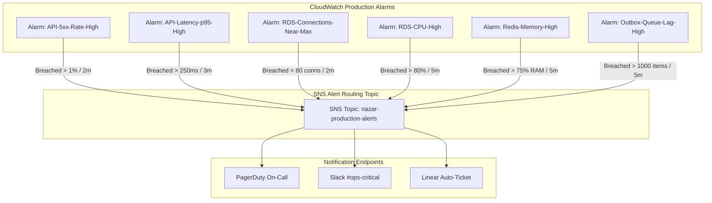

# Production Alerting Standards & Escalation Matrix

This document defines the production alert taxonomy, CloudWatch alarm definitions, threshold equations, escalation policies, and fatigue mitigation protocols for the **Nazar** platform.

---

## 1. Alert Severity Taxonomy

| Severity               | Urgency        | Notification Channel                    | Response SLA    | Action Required                                               |
| :--------------------- | :------------- | :-------------------------------------- | :-------------- | :------------------------------------------------------------ |
| **P1 - Critical**      | Immediate Page | PagerDuty + Voice/SMS + `#ops-critical` | **15 minutes**  | Active production disruption; immediate on-call mobilization  |
| **P2 - Warning**       | Elevated       | Slack `#ops-warnings` + Email           | **2 hours**     | Risk of degradation if unaddressed; next business hour review |
| **P3 - Informational** | Low            | Slack `#ops-info` / Daily Digest        | **Next Sprint** | Non-impactful trend, capacity headroom notification           |

---

## 2. Production Alarm Definitions & Thresholds



### Detailed Alarm Specifications

| Alarm Name                 | Metric & Namespace                                                | Evaluation Period        | Threshold            | Severity | Immediate Action Link                                                                                                                                                   |
| :------------------------- | :---------------------------------------------------------------- | :----------------------- | :------------------- | :------- | :---------------------------------------------------------------------------------------------------------------------------------------------------------------------- |
| `API-5xx-Rate-High`        | `AWS/ApplicationELB` `HTTPCode_Target_5XX_Count` / `RequestCount` | 2 consecutive 1m periods | **> 1.0%**           | **P1**   | [Deployment Rollback Runbook](file:///Users/subhamdas/Documents/PROJECTS/nazar/docs/infrastructure/DEPLOYMENT.md#6-automated--manual-rollback-runbook)                  |
| `API-Latency-p95-High`     | `AWS/ApplicationELB` `TargetResponseTime` (p95)                   | 3 consecutive 1m periods | **> 250 ms**         | **P1**   | [ECS Task Scaling Runbook](file:///Users/subhamdas/Documents/PROJECTS/nazar/docs/infrastructure/PRODUCTION_OPERATIONS.md#runbook-1-manual-scaling-of-api--worker-tasks) |
| `RDS-Connections-Near-Max` | `AWS/RDS` `DatabaseConnections`                                   | 2 consecutive 1m periods | **> 80 connections** | **P1**   | [Database Connection Sizing](file:///Users/subhamdas/Documents/PROJECTS/nazar/docs/infrastructure/DATABASE_OPERATIONS.md#2-connection-pool-sizing--resource-tuning)     |
| `RDS-CPU-High`             | `AWS/RDS` `CPUUtilization`                                        | 5 consecutive 1m periods | **> 80.0%**          | **P1**   | [Slow Query Profiling](file:///Users/subhamdas/Documents/PROJECTS/nazar/docs/infrastructure/DATABASE_OPERATIONS.md#5-query-profiling--observability)                    |
| `Redis-Memory-High`        | `AWS/ElastiCache` `DatabaseMemoryUsagePercentage`                 | 5 consecutive 1m periods | **> 75.0%**          | **P2**   | [Safe Redis Flush](file:///Users/subhamdas/Documents/PROJECTS/nazar/docs/infrastructure/PRODUCTION_OPERATIONS.md#runbook-2-safe-redis-ephemeral-flush)                  |
| `Outbox-Queue-Lag-High`    | `Nazar/Worker` `OutboxLagCount`                                   | 5 consecutive 1m periods | **> 1,000 events**   | **P2**   | [Stuck Outbox Triage](file:///Users/subhamdas/Documents/PROJECTS/nazar/docs/infrastructure/PRODUCTION_OPERATIONS.md#runbook-3-stuck-outbox-queue-triage--reprocessing)  |

---

## 3. Escalation Policy & On-Call Rotation

```text
Alert Triggered (P1)
  │
  ├─► [0 min] Page Primary On-Call Engineer (PagerDuty)
  │     │
  │     └─► Acknowledged? ──► YES: Mitigation begins
  │           │
  │           └─► NO (5 min elapsed)
  │                 │
  ├─► [5 min] Page Secondary On-Call Engineer
  │     │
  │     └─► Acknowledged? ──► YES: Mitigation begins
  │           │
  │           └─► NO (10 min elapsed)
  │                 │
  └─► [10 min] Escalate to Engineering Lead & Incident Commander
```

---

## 4. Alert Hygiene & Fatigue Mitigation

To prevent alert desensitization:

1. **Every Alert Must Be Actionable**: If an alert fires and no operational action is required or possible, the alarm is retired or transformed into an informational dashboard widget.
2. **Hysteresis & Multi-Period Windows**: Brief transient spikes (< 60s) do not trigger pages. Alarms require multiple consecutive breach periods.
3. **Runbook Mandatory**: Every alarm payload sent via SNS includes an immutable Markdown link to the exact troubleshooting section in `docs/infrastructure/`.
4. **Weekly Alert Review**: Any alarm firing more than 3 times in a week without leading to an incident is re-calibrated during the weekly infrastructure review.
