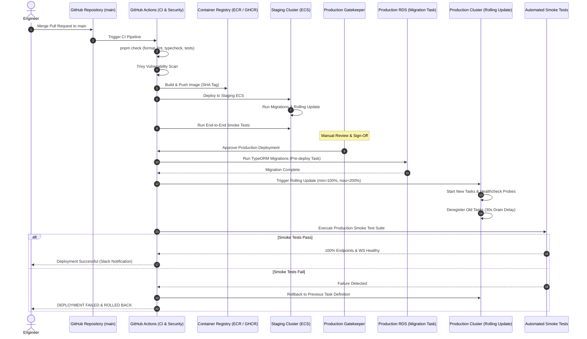

# Production Deployment Guide

This document defines the deployment engineering standards, zero-downtime rolling update mechanics, database migration protocols, and automated rollback procedures for the **Nazar** platform.

---

## 1. Release Engineering Principles

1. **Immutable Artifacts**: Every deployment packages an immutable Docker image tagged with the exact Git commit SHA (`ghcr.io/nazar/api:${{ github.sha }}`). Images are never mutated or retagged after build.
2. **Strict Environment Promotion**: Code merges to `main` undergo automated CI checks (formatting, linting, typechecking, tests, security scan) and automatically deploy to **Staging**. Production deployment requires explicit manual approval.
3. **Zero-Downtime Guarantee**: API and worker services must maintain continuous availability during rolling updates without dropping active HTTP or WebSocket connections.
4. **Pre-Deploy Database Migrations**: Database schema migrations execute as an isolated, short-lived task _before_ new application tasks begin accepting traffic.

---

## 2. CI/CD Deployment Pipelines



---

## 3. Zero-Downtime Rolling Update Mechanics

### 3.1 ECS Fargate Task Lifecycle

- **Configuration**:
  - `minimumHealthyPercent = 100`: Ensures that during deployment, the number of running tasks never drops below the desired target count.
  - `maximumPercent = 200`: Allows ECS to double the capacity temporarily, launching the new version alongside the current version.
- **Deregistration Delay**:
  - Target Group deregistration delay is configured to **30 seconds**.
  - When old tasks are targeted for removal, ALB stops routing new connections to them and allows inflight HTTP requests and WebSocket connections 30 seconds to terminate gracefully.

### 3.2 WebSocket Graceful Shutdown

- Upon receiving `SIGTERM` via `dumb-init`:
  1. The API service marks itself as unready (`/health/ready` returns 503).
  2. The ALB deregisters the task.
  3. The WebSocket server sends a close frame (`code: 1001 Going Away`) to connected clients with a randomized reconnect jitter (1–5 seconds).
  4. Clients automatically reconnect to remaining active or newly launched instances.
  5. The Node.js process exits cleanly once all connections are drained or when the 25-second shutdown grace period expires.

---

## 4. Database Migration Protocol

All database schema evolutions must obey the **Expand/Contract** pattern to ensure backward compatibility across rolling versions:

### 4.1 Backward-Compatible Migration Rules

1. **Never rename columns or tables in a single step**: Add a new column, dual-write in the application, backfill asynchronously, and remove the old column in a subsequent release.
2. **New columns must be nullable or have defaults**: Adding a `NOT NULL` column without a default will cause queries from running older tasks to crash.
3. **Create indexes concurrently**:
   ```sql
   CREATE INDEX CONCURRENTLY IF NOT EXISTS idx_users_created_at ON users (created_at);
   ```
   Prevents table-exclusive locking on production tables under high write load.
4. **Statement Timeouts**: All migrations run with `SET statement_timeout = '15s'` to prevent accidental distributed lock contention.

### 4.2 Migration Execution Steps

In GitHub Actions (`.github/workflows/deploy-production.yml`):

```yaml
- name: Run Database Migrations
  run: |
    aws ecs run-task \
      --cluster nazar-production \
      --task-definition nazar-migration-task \
      --launch-type FARGATE \
      --network-configuration "awsvpcConfiguration={subnets=[${{ secrets.PRIVATE_SUBNETS }}],securityGroups=[${{ secrets.APP_SG }}]}"
```

---

## 5. Automated Verification & Smoke Testing

Every deployment executes [`apps/api/tests/infra/deployment-smoke.test.ts`](file:///Users/subhamdas/Documents/PROJECTS/nazar/apps/api/tests/infra/deployment-smoke.test.ts) post-rollout:

1. **Liveness & Readiness**: Probes `GET /health/liveness` and `GET /health/ready`.
2. **Authentication Journey**: Performs phone login flow and issues ephemeral JWT.
3. **Core API Ingestion**: Verifies profile fetch, discovery feed query, like submission, match creation, and chat message delivery.
4. **Realtime WebSocket Connectivity**: Connects to `wss://api.nazar.app/chat/`, joins conversation room, exchanges ping/pong frame, and asserts bi-directional message receipt.
5. **Analytics Emission**: Validates event tracking ingestion without errors.

If any check fails or times out (exceeding 30 seconds), the workflow automatically invokes the rollback protocol.

---

## 6. Automated & Manual Rollback Runbook

### 6.1 Automated Rollback Triggers

- ECS Service fails to reach steady state within 10 minutes.
- Deployment smoke test fails with non-zero exit code.
- CloudWatch Alarm `API-5xx-Rate-High` fires during rollout.

### 6.2 Emergency Manual Rollback Procedure

If unexpected regressions occur post-deployment:

```bash
# 1. Inspect previous active task definition revision
aws ecs describe-services --cluster nazar-production --services nazar-api \
  --query "services[0].deployments" --output table

# 2. Update service to previous known-good task revision (e.g. revision 42)
aws ecs update-service \
  --cluster nazar-production \
  --service nazar-api \
  --task-definition nazar-api:42 \
  --force-new-deployment

# 3. Update worker service to matching revision
aws ecs update-service \
  --cluster nazar-production \
  --service nazar-worker \
  --task-definition nazar-worker:42 \
  --force-new-deployment

# 4. Monitor deployment stabilization
aws ecs wait services-stable --cluster nazar-production --services nazar-api nazar-worker
```
