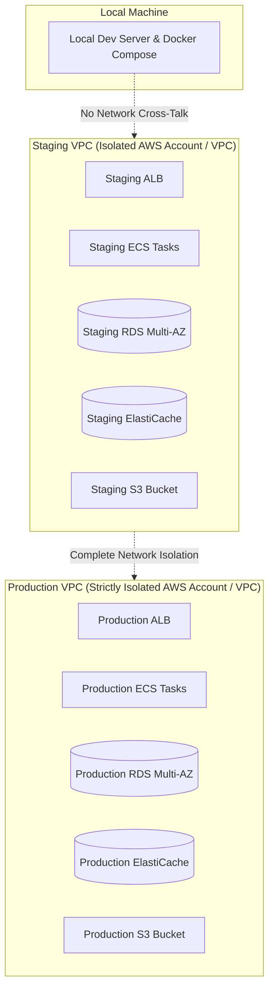

# Environment Strategy & Isolation Matrix

This document defines the multi-tier environment strategy, isolation boundaries, configuration matrix, and promotion criteria for the **Nazar** platform.

---

## 1. Environment Tier Matrix

Nazar maintains four strictly segregated environments:

| Attribute        | Local (`local`)                        | Development (`development`)              | Staging (`staging`)                     | Production (`production`)              |
| :--------------- | :------------------------------------- | :--------------------------------------- | :-------------------------------------- | :------------------------------------- |
| **Purpose**      | Developer local iteration & unit tests | Integration sandbox for feature branches | Pre-production validation & smoke tests | Live commercial workloads              |
| **Hosting**      | Local Docker Compose                   | Shared AWS Dev Cluster                   | Dedicated VPC / Multi-AZ                | Isolated Production VPC / Multi-AZ     |
| **Data Realism** | Synthetic mock seed data               | Synthetic mock seed data                 | Anonymized production-scale seed        | Authoritative user data                |
| **Database**     | Docker PostgreSQL 16                   | AWS RDS PostgreSQL Single-AZ             | AWS RDS PostgreSQL Multi-AZ             | AWS RDS PostgreSQL Multi-AZ + Replicas |
| **Redis**        | Docker Redis 7                         | AWS ElastiCache Single-Node              | AWS ElastiCache Multi-AZ                | AWS ElastiCache Multi-AZ with TLS/Auth |
| **Storage**      | MinIO (S3 API Mock)                    | AWS S3 Dev Bucket                        | AWS S3 Staging Bucket                   | AWS S3 Production Bucket (AES256/KMS)  |
| **SSL / TLS**    | Self-signed / HTTP                     | ACM Wildcard (`*.dev.nazar.app`)         | ACM Dedicated (`api.staging.nazar.app`) | ACM Strict TLS 1.3 (`api.nazar.app`)   |
| **CORS Policy**  | `localhost:*`                          | `*.dev.nazar.app`                        | `https://staging.nazar.app`             | Exact production domains only          |
| **Logging**      | Debug / Pretty console                 | Debug / JSON console                     | Info / CloudWatch Logs                  | Info / CloudWatch Logs + Redaction     |
| **Auto-Scale**   | None (1 process)                       | None (1 task)                            | 2 tasks (min)                           | 2–30 tasks (Dynamic CPU/Memory)        |

---

## 2. Environment Isolation Boundaries

### 2.1 Complete Boundary Guarantees

1. **Network Segregation**: Production and Staging operate in separate VPC CIDR blocks (`10.0.0.0/16` for Production, `10.1.0.0/16` for Staging). Cross-VPC peering is explicitly prohibited.
2. **Database Isolation**: Staging and Production databases run on separate RDS instances with completely distinct credentials, encryption keys, and security groups. Production credentials are mathematically and physically inaccessible to Staging tasks.
3. **No Cross-Environment Writes**: Local or Staging code has zero network access to production endpoints or databases.
4. **Data Sanitization**: Production customer data is never copied into Staging or Dev environments. Staging uses synthetically generated data that mirrors production distribution patterns (e.g. 10,000 synthetic profiles and interaction graphs).

---

## 3. Configuration & Validation Parity

All environments are governed by the same Zod schema validation in [`packages/config/src/server-env.ts`](file:///Users/subhamdas/Documents/PROJECTS/nazar/packages/config/src/server-env.ts).

### 3.1 Production Validation Rules

When `NODE_ENV === 'production'`:

- **`JWT_SECRET`**: Must be cryptographically secure and cannot contain default placeholders (e.g., `nazar_dev_jwt_secret`).
- **`DATABASE_URL`**: Prohibits `localhost` or `127.0.0.1`. Must specify secure host and valid connection parameters.
- **`REDIS_URL`**: Prohibits unencrypted or unauthenticated localhost connections.
- **`CORS_ORIGIN`**: Wildcard `*` is strictly disallowed; requires explicit trusted origin URLs.

### 3.2 Environment Verification Matrix Checklist

Before promoting any build from Staging to Production, verify:

- [ ] Database migrations executed successfully on Staging without downtime or lock exhaustion.
- [ ] Staging end-to-end smoke test suite passed 100%.
- [ ] Container security scan (Trivy) shows zero Critical or High vulnerabilities.
- [ ] All environment variables adhere to `server-env.ts` production Zod schema.
- [ ] Rollback plan documented and ready in case of post-deployment degradation.
