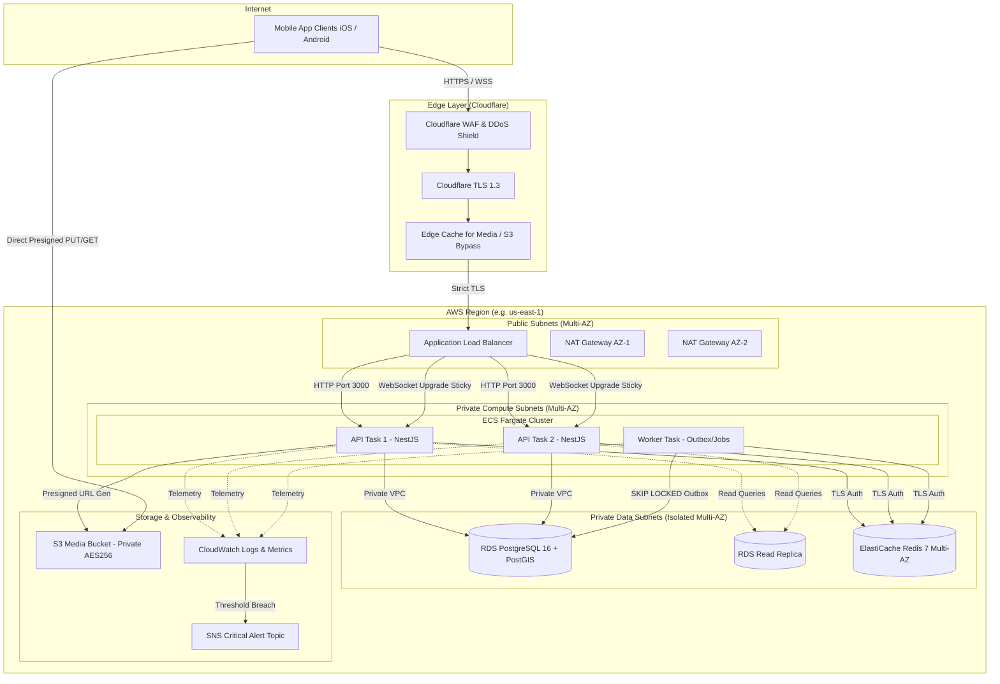

# Infrastructure Architecture

This document defines the production infrastructure architecture for the **Nazar** platform, synthesized from the empirical capacity envelopes established in Gate 17 and implemented in Gate 18.

---

## 1. Executive Summary & Design Principles

The Nazar infrastructure is built on the core principle of **operational simplicity with empirical sizing**:

- **Simplicity Over Distributed Complexity**: No Kubernetes, Kafka, or service meshes are introduced at this scale. Empirical load testing in Gate 17 demonstrated that vertical and simple horizontal scaling of PostgreSQL and containerized services comfortably satisfies workloads through 100,000 DAU.
- **Strict Data Integrity**: PostgreSQL with PostGIS is the single authoritative source of truth. Background job queues utilize PostgreSQL transactional outbox and `FOR UPDATE SKIP LOCKED` tables, guaranteeing ACID transaction boundaries.
- **Ephemeral Acceleration**: Redis is strictly utilized as an ephemeral acceleration layer (distributed rate limiting, session token caching, WebSocket socket-to-user routing, pub/sub fanout). The platform will operate safely even upon total Redis cache eviction.
- **Zero-Public Ingress to Compute**: Compute instances (ECS Fargate) and data stores (RDS, ElastiCache) reside in isolated private subnets across multiple Availability Zones. Only the Application Load Balancer and NAT Gateways have public connectivity.

---

## 2. High-Level Production Topology

---

## 3. Network Architecture & Ingress Routing

### 3.1 Edge Layer (Cloudflare)

- **DNS & TLS**: Cloudflare DNS manages apex (`nazar.app`) and subdomain records (`api.nazar.app`, `media.nazar.app`). Strict (SSL-Only) TLS 1.3 mode enforces encryption from client to edge and edge to ALB.
- **Web Application Firewall (WAF)**: Filters Layer 7 attacks, SQL injection attempts, malformed headers, and abusive IP networks before hitting the AWS perimeter.
- **Rate Limiting at Edge**: 100 requests per 10 seconds per IP for generic API endpoints; 10 requests per minute for sensitive endpoints (`/auth/otp/send`).
- **Media Caching**: Media delivery (`media.nazar.app`) caches profile and media assets at edge POPs, offloading 90%+ of media read traffic from S3.

### 3.2 Ingress Routing (AWS Application Load Balancer)

- **HTTPS Termination**: ALB terminates TLS with ACM (AWS Certificate Manager) certificates.
- **Port 80 Redirect**: Automatic HTTP (301) to HTTPS redirect on Port 80.
- **Path-Based Routing & Stickiness**:
  - `/api/v1/*` routes to target group `tg-api-http` using round-robin distribution.
  - `/chat/*` routes to target group `tg-api-ws` with ALB stickiness cookies enabled (`duration = 86400s`) ensuring long-lived WebSocket sessions maintain connection state to the terminating instance, while Redis Pub/Sub provides cross-node fanout.
- **Health Checks**: ALB probes `/health/ready` every 15 seconds. If two consecutive checks fail, the task is deregistered and traffic is directed to healthy instances.

---

## 4. Compute Architecture (ECS Fargate)

### 4.1 Containerization Design

- **Base Image**: Minimal, hardened Alpine Linux (`node:22-alpine`).
- **Non-Root Execution**: Runs under system user `node` (UID/GID 1000).
- **Process Supervisor**: `dumb-init` handles proper PID 1 signal forwarding (`SIGTERM`, `SIGINT`) and zombie reaping.
- **Multi-Stage Layering**: Builder stage compiles TypeScript and builds workspace packages (`@platform/config`, `@platform/types`); production runtime stage contains only production dependencies and compiled artifacts.
- **Local Healthcheck**: Container-level health check script queries `http://localhost:3000/health/liveness` every 10 seconds.

### 4.2 Sizing by Workload Profile (Derived from Gate 17)

| Tier         | DAU       | Target CCU | Peak Swipe RPS | Peak Chat RPS | API ECS Tasks      | Worker ECS Tasks  | Database Sizing                    |
| :----------- | :-------- | :--------- | :------------- | :------------ | :----------------- | :---------------- | :--------------------------------- |
| **Launch**   | 10,000    | 1,000      | 42             | 15            | 2 x (2 vCPU, 4GB)  | 1 x (1 vCPU, 2GB) | `db.t4g.xlarge` (4 vCPU, 16GB)     |
| **Scale**    | 100,000   | 10,000     | 416            | 156           | 6 x (4 vCPU, 8GB)  | 2 x (2 vCPU, 4GB) | `db.r6g.2xlarge` + 1 Read Replica  |
| **Regional** | 1,000,000 | 100,000    | 4,166          | 1,560         | 30 x (4 vCPU, 8GB) | 6 x (4 vCPU, 8GB) | `db.r6g.8xlarge` + 3 Read Replicas |

---

## 5. Data Persistence & Caching Tier

### 5.1 Authoritative Relational Store (RDS PostgreSQL 16 + PostGIS)

- **Multi-AZ Deployment**: Synchronous physical replication across two Availability Zones with automated failover (60–120s typical failover time).
- **Storage Subsystem**: General Purpose GP3 SSDs with provisioned baseline IOPS (3,000) and autoscaling storage up to 500GB.
- **Connection Management**:
  - Max client connections capped at 100 per instance.
  - API connection pool sized at 20 connections per task with 3-second statement timeouts to prevent connection pool exhaustion.
- **PostGIS Geospatial Indexing**: Geospatial discovery queries execute over spatial indexes (`GIST(location)`), bounding discovery sweeps within sub-15ms execution time.

### 5.2 Ephemeral Cache & State Tier (ElastiCache Redis 7)

- **Cluster Mode**: Primary-Replica replication group across Multi-AZ with automatic failover.
- **Eviction Policy**: `allkeys-lru` with strict memory limits (75% maxmemory threshold alerts).
- **Encryption**: TLS in-transit encryption and KMS customer-managed encryption at rest.
- **Fault-Tolerance**: If Redis fails entirely, API degrades gracefully (rate limiting falls back to database or open mode, session validation hits PostgreSQL, real-time messaging drops back to polling).

### 5.3 Object Storage (AWS S3)

- **Zero Public Access**: 100% block public access policy applied.
- **Direct Upload Flow**: Clients request presigned upload URLs from the API (`POST /media/presign`), then upload directly from device to S3 via encrypted HTTPS PUT.
- **Lifecycle Policies**: Incomplete multipart uploads are aborted after 1 day. Expired verification selfies transition to non-current version expiration after 30 days.

---

## 6. Architectural Decision Records (ADRs)

### ADR-01: ECS Fargate vs. Kubernetes (EKS)

- **Decision**: Adopt AWS ECS Fargate.
- **Rationale**: Nazar's architecture is a streamlined modular monolith with worker tasks. Introducing EKS adds massive control plane management overhead (ingress controllers, CNI plugins, etcd management, node group patching, Helm complexity) without performance benefit at 10k–100k DAU. Fargate eliminates server management, provides native IAM task role integration, and scales seamlessly.

### ADR-02: PostgreSQL SKIP LOCKED vs. Kafka / RabbitMQ

- **Decision**: Retain transactional outbox with PostgreSQL `FOR UPDATE SKIP LOCKED`.
- **Rationale**: Gate 17 stress tests validated outbox processing throughput exceeding 1,200 events/sec with under 5ms queue latency. This avoids dual-write consistency hazards between database transactions and message brokers, eliminating external broker operational burden.

### ADR-03: Ephemeral Redis vs. Persistent Redis

- **Decision**: Treat Redis strictly as ephemeral cache and real-time coordination layer.
- **Rationale**: No persistent domain state (user accounts, messages, matches, payments) may live solely in Redis. This prevents data loss during node failover or memory eviction events.
