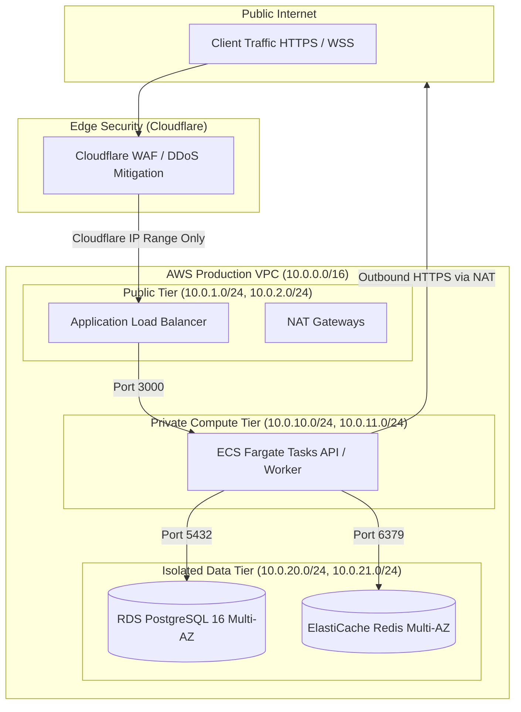

# Production Network Security Architecture

This document defines the network isolation topology, security group matrix, ingress/egress filtering rules, and transport encryption policies for the **Nazar** production infrastructure.

---

## 1. Network Topology & Subnet Segmentation

Nazar uses a multi-tier Virtual Private Cloud (VPC) spanning multiple Availability Zones with strict network zoning:

### 1.1 Subnet Allocation

- **Public Subnet**: Holds ALB and NAT Gateways. Routes to AWS Internet Gateway (`igw-xxxx`).
- **Private Compute Subnet**: Holds ECS Fargate container instances. Default route points to NAT Gateway for outbound egress (Stripe, Twilio, Push notifications). Zero direct inbound internet access.
- **Isolated Data Subnet**: Holds RDS PostgreSQL and ElastiCache Redis. Zero internet routing (no NAT gateway route, no IGW route). Only reachable via internal VPC routes from the Private Compute Subnet.

---

## 2. Security Group Ingress / Egress Matrix

Every resource operates under strict least-privilege security groups:

| Security Group                           | Ingress Rules                                                                                                    | Egress Rules                                                                                                  |
| :--------------------------------------- | :--------------------------------------------------------------------------------------------------------------- | :------------------------------------------------------------------------------------------------------------ |
| **`sg-alb` (Application Load Balancer)** | • Port 443 TCP from Cloudflare IP ranges only • Port 80 TCP from Cloudflare IP ranges only (for 301 redirect) | • Port 3000 TCP to `sg-ecs-tasks` only                                                                        |
| **`sg-ecs-tasks` (API & Workers)**       | • Port 3000 TCP from `sg-alb` only                                                                               | • Port 5432 TCP to `sg-rds` • Port 6379 TCP to `sg-redis` • Port 443 TCP to 0.0.0.0/0 (via NAT Gateway) |
| **`sg-rds` (PostgreSQL)**                | • Port 5432 TCP from `sg-ecs-tasks` only                                                                         | • None (Deny all outbound)                                                                                    |
| **`sg-redis` (ElastiCache)**             | • Port 6379 TCP from `sg-ecs-tasks` only                                                                         | • None (Deny all outbound)                                                                                    |

---

## 3. Ingress Filtering & Edge Protection

### 3.1 Cloudflare Origin Locking

The Application Load Balancer only accepts traffic originating from Cloudflare's published IP CIDR blocks. Any direct connection attempts targeting the ALB's raw DNS hostname or IP address are immediately dropped at the AWS security group layer.

### 3.2 Web Application Firewall (WAF) Protections

- **OWASP Top 10 Ruleset**: Protects against SQL Injection, Cross-Site Scripting, and Local File Inclusion attempts.
- **Bot Management**: Blocks known scraper networks, malicious crawlers, and automated credential stuffing tools.
- **Adaptive Rate Limiting**:
  - Global API: 120 req / 10s per IP.
  - Authentication `/auth/*`: 5 req / minute per IP.

---

## 4. Administrative Access & SSM Session Manager

- **Zero Open Port 22**: Production instances and VPCs have port 22 completely disabled.
- **AWS Systems Manager (SSM) Session Manager**:
  - Diagnostic administrative shell sessions connect exclusively via AWS SSM Session Manager.
  - IAM permissions require Multi-Factor Authentication (MFA).
  - All interactive terminal sessions are fully logged, audited, and streamed to CloudWatch Logs with non-repudiation timestamps.
