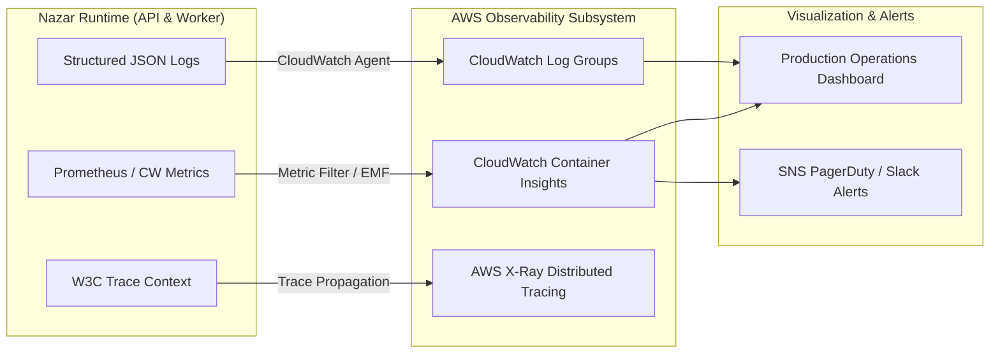

# Production Observability & Telemetry Standard

This document defines the production observability architecture, structured logging formats, distributed tracing, golden signal monitoring, and health checking protocols for the **Nazar** platform.

---

## 1. Observability Architecture

Nazar adheres to the **Three Pillars of Observability** integrated directly into the application runtime:



---

## 2. Structured JSON Logging & PII Sanitization

### 2.1 Log Schema

All application logs are emitted as single-line JSON objects to standard output (`stdout`):

```json
{
  "timestamp": "2026-09-29T20:10:00.123Z",
  "level": "info",
  "correlationId": "corr_c1d2e3f4-g5h6-7890",
  "userId": "usr_98765432-abcd",
  "route": "/api/v1/discovery/feed",
  "method": "GET",
  "statusCode": 200,
  "durationMs": 14.2,
  "message": "Discovery feed generated successfully",
  "environment": "production"
}
```

### 2.2 Strict PII Redaction

Application loggers enforce automatic redaction masks on sensitive fields before emitting output:

- `phone`: Replaced with `+1***-***-1234`
- `authorization` / `token` / `jwt`: Replaced with `[REDACTED]`
- `password` / `pin` / `otp`: Replaced with `[REDACTED]`
- `location` / `coordinates`: Coordinates rounded or obscured in debug output.

---

## 3. Distributed Tracing & Correlation IDs

Every inbound HTTP and WebSocket request is assigned a unique `correlationId`:

1. **HTTP Ingestion**: Middleware checks for incoming `x-correlation-id` header; if missing, generates a UUIDv4.
2. **Context Propagation**: The correlation ID is attached to the NestJS request execution context using `AsyncLocalStorage`.
3. **Outbox Events**: Outbox database records include the originator `correlation_id`, allowing worker tasks to correlate asynchronous background events back to the originating HTTP request.

---

## 4. The Four Golden Signals

Nazar monitors the Four Golden Signals across all production workloads:

| Golden Signal  | Metric Name                                 | Launch Threshold   | Scale Threshold     | Critical Alarm        |
| :------------- | :------------------------------------------ | :----------------- | :------------------ | :-------------------- |
| **Latency**    | `ALB.TargetResponseTime`                    | p95 < 120ms        | p95 < 180ms         | p95 > 250ms for 3m    |
| **Traffic**    | `ALB.RequestCount`                          | ~42 RPS peak       | ~416 RPS peak       | > 2x forecasted surge |
| **Errors**     | `ALB.HTTPCode_Target_5XX_Count`             | < 0.1% of requests | < 0.05% of requests | > 1% 5xx over 2m      |
| **Saturation** | `ECS.CPUUtilization` / `RDS.CPUUtilization` | < 60% sustained    | < 70% sustained     | > 80% for 5m          |

---

## 5. Domain-Specific Telemetry & Counters

In addition to system metrics, Nazar emits domain counters via Embedded Metric Format (EMF):

- `nazar.swipes.processed`: Count of like/pass actions per minute.
- `nazar.matches.created`: Instantaneous count of mutual matches generated.
- `nazar.chat.active_connections`: Current number of established WebSocket connections.
- `nazar.outbox.unprocessed_count`: Real-time queue lag of pending outbox events.
- `nazar.recommendations.scoring_latency`: Duration in milliseconds to compute candidate scores.
