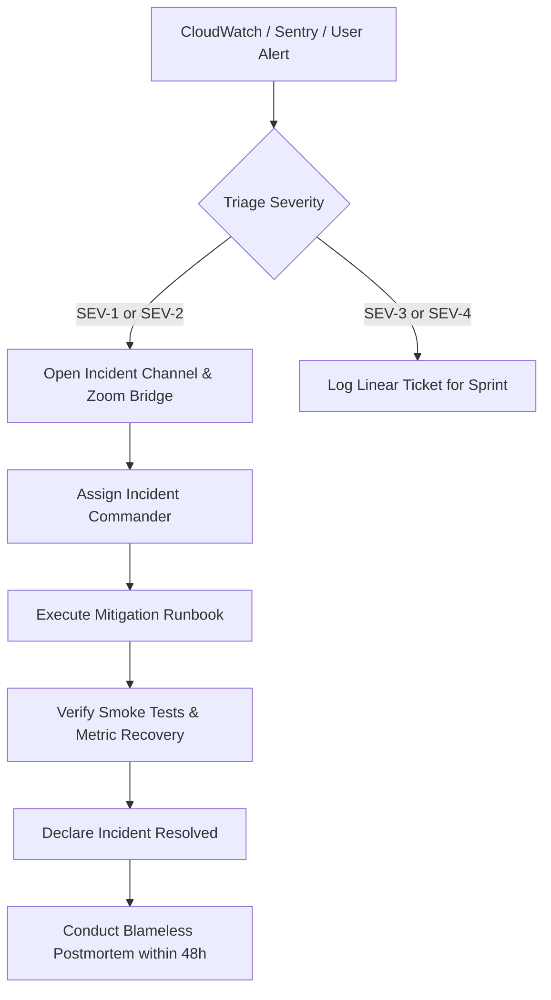

# Production Operations & Incident Runbook

This document defines standard operating procedures, routine operational runbooks, incident management protocols, and troubleshooting guides for the **Nazar** platform.

---

## 1. Incident Severity Levels & Response SLAs

| Severity             | Definition                                                 | Examples                                                                       | Response SLA       | Target Resolution |
| :------------------- | :--------------------------------------------------------- | :----------------------------------------------------------------------------- | :----------------- | :---------------- |
| **SEV-1 (Critical)** | Complete platform outage or severe data compromise         | All API endpoints returning 5xx; database inaccessible; active security breach | **15 minutes**     | **< 2 hours**     |
| **SEV-2 (Major)**    | Major functionality impaired; significant user degradation | Real-time chat down; swipe matching failing; payment processing degraded       | **30 minutes**     | **< 4 hours**     |
| **SEV-3 (Minor)**    | Non-critical functionality degraded; workaround available  | Profile avatar processing delayed; analytics ingestion lagging                 | **2 hours**        | **< 24 hours**    |
| **SEV-4 (Low)**      | Cosmetic or minor operational inconvenience                | Admin console report export slow; minor logging formatting issue               | **1 business day** | Next sprint       |

---

## 2. Incident Management Workflow



### Incident Roles

- **Incident Commander (IC)**: Directs triage, assigns investigation tracks, authorizes rollbacks or emergency changes.
- **Tech Lead**: Investigates logs, profiles metrics, applies patches or configuration adjustments.
- **Communications Lead**: Posts updates to status page (`status.nazar.app`) and notifies internal stakeholders every 30 minutes during SEV-1.

---

## 3. Routine Operational Runbooks

### Runbook 1: Manual Scaling of API / Worker Tasks

When unexpected traffic spikes occur (e.g. major marketing campaign, celebrity mention):

```bash
# Scale API to 10 tasks immediately
aws ecs update-service \
  --cluster nazar-production \
  --service nazar-api \
  --desired-count 10

# Scale background workers to 4 tasks
aws ecs update-service \
  --cluster nazar-production \
  --service nazar-worker \
  --desired-count 4
```

### Runbook 2: Safe Redis Ephemeral Flush

If Redis memory becomes corrupted or invalid cache keys cause operational instability:

```bash
# Redis is strictly an ephemeral accelerator; flushing will NOT cause data loss
# Connect via redis-cli on bastion host
redis-cli -h nazar-redis.c1234.use1.cache.amazonaws.com -p 6379 -a "$REDIS_AUTH_TOKEN" --tls FLUSHDB ASYNC
```

_Note: `ASYNC` ensures the flush does not block the Redis single-threaded event loop._

### Runbook 3: Stuck Outbox Queue Triage & Reprocessing

If outbox queue processing lags behind real-time events:

```sql
-- 1. Check count of unprocessed or failed outbox events
SELECT status, count(*)
FROM outbox_events
GROUP BY status;

-- 2. Identify top error causes
SELECT last_error, count(*)
FROM outbox_events
WHERE status = 'FAILED'
GROUP BY last_error
ORDER BY count(*) DESC
LIMIT 5;

-- 3. Reset failed events for retry once root cause is resolved
UPDATE outbox_events
SET status = 'PENDING', retry_count = 0
WHERE status = 'FAILED'
  AND created_at > NOW() - INTERVAL '6 hours';
```

### Runbook 4: Investigating Container Memory Pressure / Leaks

If ECS tasks experience high memory alarms:

```bash
# Check container memory metrics via CloudWatch Container Insights
aws logs filter-log-events \
  --log-group-name /ecs/nazar-api-production \
  --filter-pattern "OutOfMemory"

# Capture memory usage across tasks
aws cloudwatch get-metric-data --metric-data-queries file://memory-query.json
```

---

## 4. Post-Incident Postmortem Process

Within 48 hours of any SEV-1 or SEV-2 incident resolution:

1. Conduct a **blameless postmortem meeting** involving engineering and product stakeholders.
2. Compile formal postmortem document covering:
   - Incident Timeline (T0 detection, T1 triage, T2 mitigation, T3 resolution).
   - Root Cause Analysis (5 Whys methodology).
   - What went well, what went poorly, where we got lucky.
   - Preventive Action Items with assigned owners and Jira/Linear ticket tracking.
