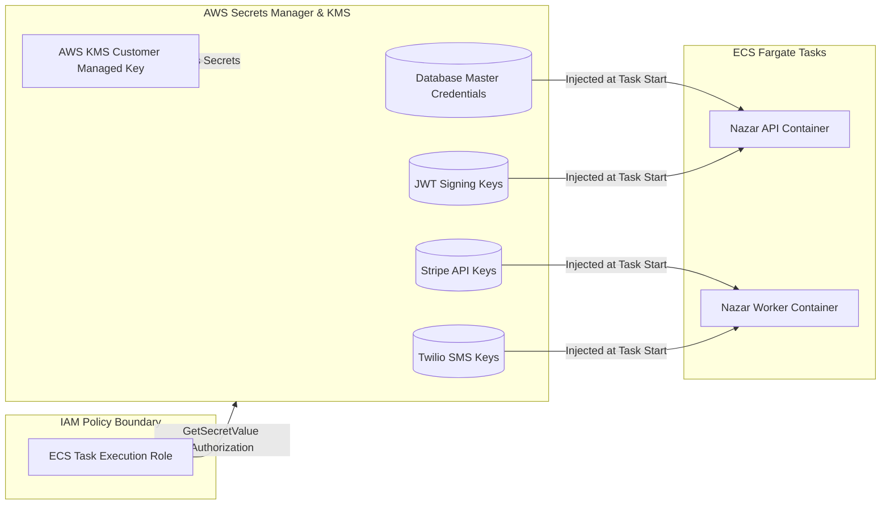

# Secrets Management & Key Rotation Architecture

This document outlines the security controls, injection mechanisms, classification tiers, and rotation protocols for cryptographic keys and secrets in the **Nazar** platform.

---

## 1. Secrets Management Architecture

Nazar enforces zero-plaintext storage of credentials in code repositories, Docker images, and CI build artifacts.



### 1.1 Ingestion into Containers

Secrets are never written to disk or embedded in environment files. ECS Fargate task definitions reference AWS Secrets Manager ARNs:

```json
{
  "secrets": [
    {
      "name": "DATABASE_URL",
      "valueFrom": "arn:aws:secretsmanager:us-east-1:123456789012:secret:nazar/production/database_url"
    },
    {
      "name": "JWT_SECRET",
      "valueFrom": "arn:aws:secretsmanager:us-east-1:123456789012:secret:nazar/production/jwt_secret"
    }
  ]
}
```

At container startup, the AWS ECS agent retrieves the decrypted value over internal AWS endpoints using the Task Execution IAM Role and sets it in memory.

---

## 2. Secret Classification & Sensitivity Levels

| Tier                     | Category                               | Secrets Included                                                    | Storage Mechanism                      | Rotation Frequency          |
| :----------------------- | :------------------------------------- | :------------------------------------------------------------------ | :------------------------------------- | :-------------------------- |
| **Tier 1 (Critical)**    | Core Authentication & Authoritative DB | `DATABASE_URL`, `JWT_SECRET`, `REDIS_AUTH_TOKEN`, KMS Master Key    | AWS Secrets Manager + KMS Multi-AZ     | 90 Days / Immediate on Leak |
| **Tier 2 (High)**        | Financial & Telephony Gateways         | `STRIPE_SECRET_KEY`, `STRIPE_WEBHOOK_SECRET`, `TWILIO_AUTH_TOKEN`   | AWS Secrets Manager                    | 180 Days                    |
| **Tier 3 (Operational)** | Telemetry & Edge Security              | `CLOUDFLARE_API_TOKEN`, `SENTRY_DSN`, `AWS_ACCESS_KEY_ID` (CI only) | AWS SSM Parameter Store (SecureString) | 365 Days                    |

---

## 3. Secret Rotation Protocols

### 3.1 Zero-Downtime JWT Secret Rotation

Nazar supports dual-key verification during JWT rotation:

1. Generate new 64-character cryptographic string: `openssl rand -hex 32`.
2. Update AWS Secrets Manager secret `nazar/production/jwt_secret_new`.
3. Application loads both `JWT_SECRET` (used for signing new tokens and verification) and `JWT_SECRET_PREVIOUS` (used for verification fallback).
4. Deploy API tasks with both keys. Active user sessions remain valid using the previous key, while all newly issued tokens use the primary key.
5. After token expiration window (e.g. 7 days), remove `JWT_SECRET_PREVIOUS` and complete rotation.

### 3.2 Database Credential Rotation

1. RDS automated rotation utilizes AWS Lambda rotation function (`SecretsManagerRDSPostgreSQLRotationSingleUser`).
2. The Lambda updates the password in PostgreSQL, tests the connection, and updates the secret in Secrets Manager.
3. ECS tasks are restarted with a rolling deployment to pick up the updated database credentials without interruption.

---

## 4. Access Auditing & Monitoring

- **CloudTrail Logging**: Every `secretsmanager:GetSecretValue` and `kms:Decrypt` API call is captured in CloudTrail with IP address, caller identity, and timestamp.
- **Alerting**: Any access attempt to secrets by unauthorized IAM roles or IP addresses outside the private VPC generates an immediate P1 alert via SNS to the Security Incident Response Team.

---

## 5. Compromise & Emergency Revocation Runbook

If a secret is suspected of exposure:

1. **Immediate Revocation**: Invalidate the compromised token at the provider (e.g. roll Stripe API key in dashboard; revoke Twilio token).
2. **Rotate in Secrets Manager**: Write new secret to AWS Secrets Manager.
3. **Emergency Rolling Restart**:
   ```bash
   aws ecs update-service --cluster nazar-production --service nazar-api --force-new-deployment
   aws ecs update-service --cluster nazar-production --service nazar-worker --force-new-deployment
   ```
4. **Invalidate Active Sessions**: If `JWT_SECRET` was leaked, run administrative revocation command to invalidate all active session tokens in Redis.
5. **Post-Mortem**: Document root cause, blast radius, and remediations.
