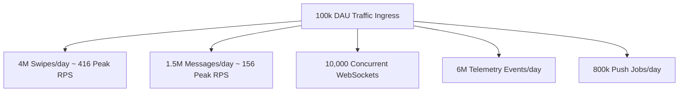
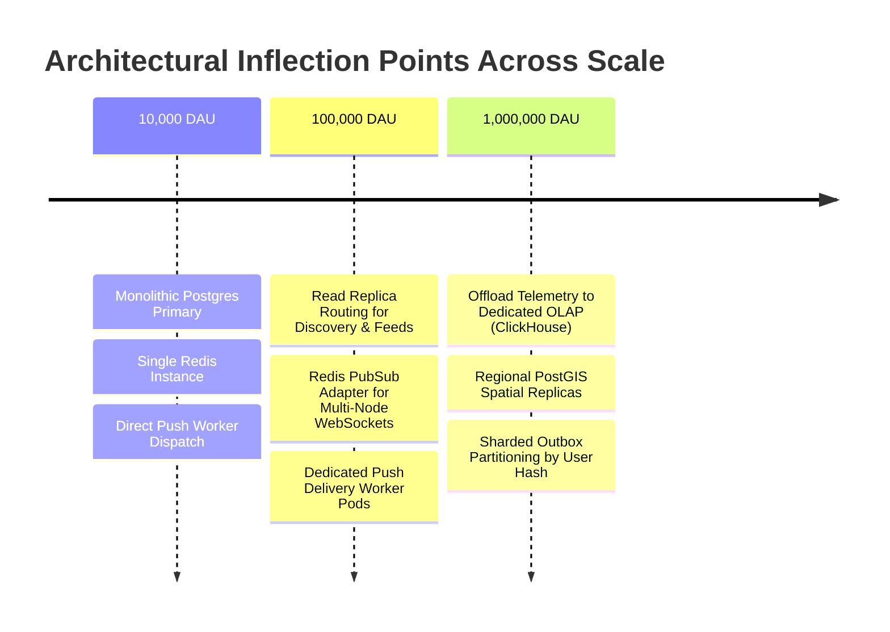

# CAPACITY MODEL & SCALE PROJECTIONS · NAZAR PLATFORM

## 1. Executive Summary & Growth Milestones

This capacity model establishes the compute, memory, database, storage, and network requirements for the Nazar platform across three operational tiers:

- **Tier 1: 10,000 Daily Active Users (DAU)** · Initial regional launch (London, Istanbul)
- **Tier 2: 100,000 Daily Active Users (DAU)** · Multi-city / national deployment
- **Tier 3: 1,000,000 Daily Active Users (DAU)** · Global multi-region deployment

The model uses behavioral multipliers derived from real-world social and dating platform telemetry.

---

## 2. Workload & Traffic Modeling Assumptions

| Activity Metric                 |   Per Active User / Day   |   Tier 1 (10k DAU)    |    Tier 2 (100k DAU)    |       Tier 3 (1M DAU)       |
| :------------------------------ | :-----------------------: | :-------------------: | :---------------------: | :-------------------------: |
| **Peak Concurrency Factor**     |    10% peak concurrent    |     **1,000 CCU**     |     **10,000 CCU**      |       **100,000 CCU**       |
| **Discovery Swipes**            |     40 swipes / user      |     400,000 / day     |     4,000,000 / day     |      40,000,000 / day       |
| **Average Swipe RPS (Peak 3x)** |             —             | **14 RPS** (Peak: 42) | **138 RPS** (Peak: 416) | **1,388 RPS** (Peak: 4,166) |
| **Chat Messages**               |    15 messages / user     |     150,000 / day     |     1,500,000 / day     |      15,000,000 / day       |
| **Chat RPS (Peak 3x)**          |             —             | **5 RPS** (Peak: 15)  | **52 RPS** (Peak: 156)  |  **520 RPS** (Peak: 1,560)  |
| **WebSocket Connections**       | 1 socket / active session |     1,000 sockets     |     10,000 sockets      |       100,000 sockets       |
| **Push Notifications**          |      8 pushes / user      |     80,000 / day      |      800,000 / day      |       8,000,000 / day       |
| **Telemetry Events**            |     60 events / user      |     600,000 / day     |     6,000,000 / day     |      60,000,000 / day       |
| **Media Uploads**               |     0.2 photos / user     |      2,000 / day      |      20,000 / day       |        200,000 / day        |

---

## 3. Infrastructure Sizing by Growth Tier

### Tier 1: 10,000 DAU (Early Regional Scale)

_Architecture Profile: Single-Region Primary Node Deployment_

| Component          | Hardware / Instance Spec                  | Configuration & Allocation                       |
| :----------------- | :---------------------------------------- | :----------------------------------------------- |
| **API Servers**    | 2 instances $\times$ 2 vCPU, 4GB RAM      | Load balanced, running NestJS runtime.           |
| **PostgreSQL 16**  | 1 instance $\times$ 4 vCPU, 16GB RAM, SSD | `shared_buffers = 4GB`, `max_connections = 100`. |
| **Redis 7**        | 1 instance $\times$ 2 vCPU, 4GB RAM       | Handles session cache, swipe exclusion sets.     |
| **Async Workers**  | 1 instance $\times$ 2 vCPU, 4GB RAM       | Handles outbox consumption and push dispatch.    |
| **Storage (S3)**   | Object storage with CloudFront CDN        | ~250 GB media storage, 50 GB database storage.   |
| **Estimated Cost** | ~$200 – $350 / month                      | High efficiency, 85% headroom.                   |

---

### Tier 2: 100,000 DAU (Multi-City National Scale)

_Architecture Profile: Read-Replica Separation + Redis PubSub Cluster_

| Component               | Hardware / Instance Spec                   | Configuration & Allocation                                                |
| :---------------------- | :----------------------------------------- | :------------------------------------------------------------------------ |
| **API Servers**         | 6 instances $\times$ 4 vCPU, 8GB RAM       | Stateless HTTP + WebSocket termination.                                   |
| **PostgreSQL Primary**  | 1 instance $\times$ 8 vCPU, 32GB RAM, NVMe | Handles all transactional writes (`interactions`, `matches`, `messages`). |
| **PostgreSQL Replicas** | 2 instances $\times$ 8 vCPU, 32GB RAM      | Streaming replication; offloads discovery and community feeds.            |
| **Redis Cluster**       | 3 nodes $\times$ 4 vCPU, 16GB RAM          | Dedicated instances for Socket.io PubSub vs Cache.                        |
| **Async Workers**       | 3 instances $\times$ 4 vCPU, 8GB RAM       | Dedicated outbox worker, delivery worker, recommendation worker.          |
| **Storage (S3)**        | Object storage + CDN Edge Caching          | ~2.5 TB media storage, 500 GB database storage.                           |
| **Estimated Cost**      | ~$1,800 – $2,500 / month                   | Sustains up to 1,500 peak combined RPS.                                   |

---

### Tier 3: 1,000,000 DAU (Global Multi-Region Platform)

_Architecture Profile: Geographic Read Clustering + Dedicated Analytics Warehouse_

| Component              | Hardware / Instance Spec                          | Configuration & Allocation                                                |
| :--------------------- | :------------------------------------------------ | :------------------------------------------------------------------------ |
| **API Servers**        | 30 instances across 3 global regions              | Sized for 100,000 concurrent sockets and 6,000 peak RPS.                  |
| **PostgreSQL Primary** | High-Availability Cluster (16 vCPU, 64GB RAM)     | Dedicated writer instance with automated failover.                        |
| **PostGIS Replicas**   | Regional Read Replicas (London, NYC, Singapore)   | Eliminates cross-oceanic WAN latency for spatial discovery.               |
| **Analytics Engine**   | Dedicated OLAP Warehouse (ClickHouse / Snowflake) | Asynchronous ingestion pipeline offloading PostgreSQL `analytics_events`. |
| **Redis Cluster**      | 6-node Redis 7 Cluster (64GB RAM total)           | Distributed memory caching, presence, and pubsub channels.                |
| **Workers**            | 12 autoscaling worker pods                        | Consuming partitioned outbox queues.                                      |
| **Storage (S3)**       | 25 TB S3 with global CDN image optimization       | Avif/WebP dynamic on-the-fly resizing.                                    |

---

## 4. Bottleneck Progression & Architectural Inflection Points

1. **First Bottleneck (~40k DAU)**: Discovery queries saturating primary DB CPU.  
   _Remedy_: Route `GET /v1/discovery` to PostgreSQL read replicas using replica connection pool routing.
2. **Second Bottleneck (~120k DAU)**: WebSocket socket limits on single Node.js process.  
   _Remedy_: Add `@socket.io/redis-adapter` to distribute chat events across multiple API nodes seamlessly.
3. **Third Bottleneck (~300k DAU)**: `analytics_events` table size growth (6M rows/day = 180M rows/month).  
   _Remedy_: Partition `analytics_events` monthly by `occurred_at` or direct stream into ClickHouse via worker batching.
4. **Fourth Bottleneck (~800k DAU)**: Outbox event table contention on primary writer.  
   _Remedy_: Partition `outbox_events` by hash of `aggregate_id` into 8 separate queue tables claimed by isolated worker threads.
