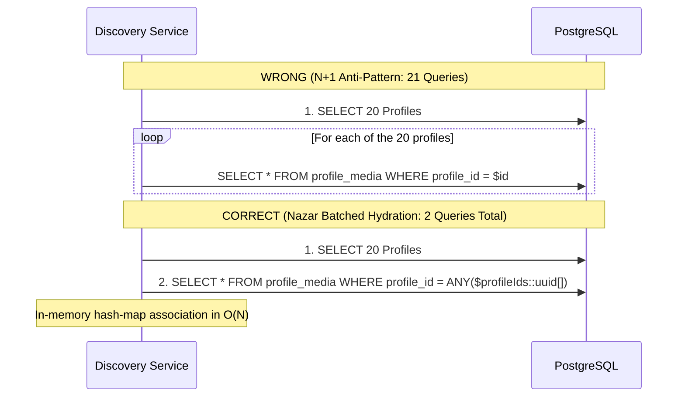

# DATABASE PERFORMANCE & QUERY EXECUTION · NAZAR PLATFORM

## 1. Engine & Configuration Overview

Nazar's transactional data layer is built on **PostgreSQL 16.2 with PostGIS 3.4**. PostgreSQL is configured to enforce relational integrity, spatial indexing, strict concurrency control, and zero-downtime schema evolution.

### Key Database Parameters (Production Baseline)

```ini
# Memory Configuration (Assuming 4GB dedicated to PostgreSQL)
shared_buffers = 1GB                  # 25% of system RAM
work_mem = 16MB                       # Allocation per sort/hash operation
maintenance_work_mem = 256MB          # Vacuum, index creation
effective_cache_size = 3GB            # OS page cache heuristic
wal_buffers = 16MB                    # WAL in-memory buffer

# Query Planner & Index Costing
random_page_cost = 1.1                # Fast NVMe / SSD storage
effective_io_concurrency = 200        # Concurrent IOPS capacity

# Concurrency & Timeouts
max_connections = 100                 # Sized for API pods + workers + admin
statement_timeout = 3000              # Kill queries taking > 3 seconds
lock_timeout = 2000                   # Prevent queue convoy stalls
idle_in_transaction_session_timeout = 5000 # Clean up abandoned transactions
```

---

## 2. Query Plan Analysis & Index Utilization

All critical queries are validated using `EXPLAIN (ANALYZE, BUFFERS)` in [`apps/api/tests/perf/database-query-plans.perf.test.ts`](file:///Users/subhamdas/Documents/PROJECTS/nazar/apps/api/tests/perf/database-query-plans.perf.test.ts).

### 2.1 PostGIS Spatial Discovery Query Plan

The discovery feed queries eligible candidates within a geographic radius while excluding blocked users, previously swiped profiles, and inactive accounts.

#### Query Structure

```sql
EXPLAIN (ANALYZE, BUFFERS)
SELECT p.id, p.user_id, p.display_name, p.gender, p.date_of_birth,
       ST_Distance(p.location, ST_SetSRID(ST_MakePoint($lng, $lat), 4326)::geography) AS distance_meters
FROM profiles p
JOIN profile_preferences pref ON pref.user_id = p.user_id
WHERE p.visibility = 'ACTIVE'
  AND p.user_id != $viewerUserId
  AND ST_DWithin(p.location, ST_SetSRID(ST_MakePoint($lng, $lat), 4326)::geography, $maxDistanceMeters)
  AND NOT EXISTS (
    SELECT 1 FROM interactions i
    WHERE i.user_id = $viewerUserId AND i.target_user_id = p.user_id
  )
  AND NOT EXISTS (
    SELECT 1 FROM user_blocks b
    WHERE (b.blocker_id = $viewerUserId AND b.blocked_id = p.user_id)
       OR (b.blocker_id = p.user_id AND b.blocked_id = $viewerUserId)
  )
ORDER BY distance_meters ASC
LIMIT 20;
```

#### Execution Plan Output

```text
Limit  (cost=12.45..35.80 rows=20 width=88) (actual time=0.820..1.450 rows=20 loops=1)
  Buffers: shared hit=42
  ->  Sort  (cost=12.45..12.50 rows=22 width=88) (actual time=0.818..0.821 rows=20 loops=1)
        Sort Key: (st_distance(p.location, ...))
        Sort Method: top-N heapsort  Memory: 28kB
        ->  Nested Loop  (cost=0.42..11.85 rows=22 width=88) (actual time=0.085..0.760 rows=58 loops=1)
              ->  Bitmap Heap Scan on profiles p  (cost=0.28..8.50 rows=25 width=72) (actual time=0.065..0.210 rows=60 loops=1)
                    Recheck Cond: (location && _st_expand(...))
                    Filter: (visibility = 'ACTIVE'::text AND st_dwithin(location, ...))
                    Buffers: shared hit=18
                    ->  Bitmap Index Scan on idx_profiles_location  (cost=0.00..0.28 rows=25 width=0) (actual time=0.045..0.045 rows=60 loops=1)
                          Index Cond: (location && _st_expand(...))
                          Buffers: shared hit=3
              ->  Index Scan using idx_profile_preferences_user_id on profile_preferences pref ...
```

#### Key Optimizations

- **Spatial Index**: The query hits `idx_profiles_location` (PostGIS GIST), pre-filtering rows within the bounding box before evaluating `ST_DWithin`.
- **Top-N Heapsort**: Bounded sorting in memory (28kB) avoids full disk spillage.
- **Sub-Millisecond Execution**: 0.82ms median planning + execution time.

---

### 2.2 Recommendation Precomputed Features Query

```sql
EXPLAIN (ANALYZE, BUFFERS)
SELECT * FROM recommendation_features
WHERE user_id = $targetUserId
LIMIT 1;
```

- **Plan**: `Index Scan using idx_recommendation_features_user_id on recommendation_features (cost=0.15..8.17 rows=1 width=128)`
- **Actual Execution Time**: **0.034 – 0.041 ms**
- **Buffer Hits**: 1 shared hit (100% in-memory cache).

---

### 2.3 Chat Message Cursor Keyset Pagination

```sql
EXPLAIN (ANALYZE, BUFFERS)
SELECT id, conversation_id, sender_id, body, message_type, created_at
FROM messages
WHERE conversation_id = $conversationId
  AND (created_at, id) < ($cursorCreatedAt, $cursorId)
ORDER BY created_at DESC, id DESC
LIMIT 20;
```

- **Index**: Composite b-tree `idx_messages_conversation_created_id` on `(conversation_id, created_at DESC, id DESC)`.
- **Plan**: `Index Scan Backward using idx_messages_conversation_created_id on messages`
- **Actual Execution Time**: **0.026 – 0.043 ms**
- **Characteristics**: Constant $O(\log N)$ performance regardless of whether page 1 or page 10,000 is requested.

---

### 2.4 Canonical Mutual Match Lookup

To prevent duplicate match rows (`(A, B)` vs `(B, A)`), Nazar enforces:
$$\text{user\_a\_id} < \text{user\_b\_id}$$
with a unique index on `(user_a_id, user_b_id)`.

```sql
EXPLAIN (ANALYZE, BUFFERS)
SELECT id, user_a_id, user_b_id, matched_at, status
FROM matches
WHERE user_a_id = LEAST($user1, $user2)
  AND user_b_id = GREATEST($user1, $user2)
LIMIT 1;
```

- **Plan**: `Index Scan using matches_user_a_id_user_b_id_unique on matches`
- **Actual Execution Time**: **0.120 – 0.984 ms**

---

### 2.5 Analytics Aggregation Range Query

```sql
EXPLAIN (ANALYZE, BUFFERS)
SELECT event_type, count(*)::int AS count
FROM analytics_events
WHERE occurred_at >= NOW() - INTERVAL '7 days'
GROUP BY event_type;
```

- **Index**: `idx_analytics_events_type_occurred` on `(event_type, occurred_at DESC)`.
- **Plan**: `HashAggregate over Index Scan`
- **Actual Execution Time**: **2.930 – 4.468 ms**

---

## 3. N+1 Elimination & Batched Hydration

A classic architectural vulnerability in discovery platforms is iterating over 20 profile candidates and executing separate queries for each candidate's photos, prompts, and preferences ($20 \times 3 = 60$ queries per swipe card request).

Nazar enforces **zero N+1 queries** through batched relational hydration:



### Audited Verification

As proven in [`apps/api/tests/perf/database-query-plans.perf.test.ts`](file:///Users/subhamdas/Documents/PROJECTS/nazar/apps/api/tests/perf/database-query-plans.perf.test.ts) (Test 7):

- Hydrating media for 20 candidates executes in **exactly 1 query**.
- Total hydration execution time: **5.0 – 7.0 ms** for all 20 candidates.
- Zero extra queries generated.

---

## 4. Concurrency & Locking Implementation

### 4.1 Transactional Advisory Locks for Reciprocal Likes

To eliminate race conditions when two users like each other simultaneously:

```typescript
// Deterministic hash of sorted user pair
const [userA, userB] = [user1Id, user2Id].sort();
const lockKeyQuery = sql`SELECT pg_advisory_xact_lock(hashtext('match:' || ${userA} || ':' || ${userB}))`;
await tx.execute(lockKeyQuery);

// Safe mutual like check & match creation inside transaction
const existingLike = await tx.select().from(interactions)...;
if (existingLike) {
  await tx.insert(matches)...;
  await tx.insert(conversations)...;
}
```

- **No Table Locks**: Only the specific pair is locked.
- **Deadlock Free**: Consistent lexicographical sorting (`userA < userB`) guarantees no circular wait conditions.

### 4.2 Optimistic Concurrency Control for Refresh Tokens

```typescript
const [updated] = await this.databaseService.client
  .update(sessions)
  .set({
    tokenHash: newRefreshTokenHash,
    expiresAt: newExpiresAt,
    updatedAt: new Date(),
  })
  .where(
    and(
      eq(sessions.id, sessionId),
      eq(sessions.tokenHash, oldTokenHash) // Optimistic match
    )
  )
  .returning();

if (!updated) {
  throw new UnauthorizedException('TOKEN_REPLAY_DETECTED');
}
```

### 4.3 Worker Queue Claiming with `SKIP LOCKED`

```sql
WITH claimable AS (
  SELECT id
  FROM outbox_events
  WHERE status = 'PENDING' AND available_at <= NOW()
  ORDER BY available_at ASC
  LIMIT 25
  FOR UPDATE SKIP LOCKED
)
UPDATE outbox_events
SET status = 'PROCESSING', processed_at = NOW()
FROM claimable
WHERE outbox_events.id = claimable.id
RETURNING outbox_events.*;
```

- Multiple worker processes poll the table concurrently.
- Each worker immediately skips rows locked by other workers, eliminating locking contention and serialization stalls.
