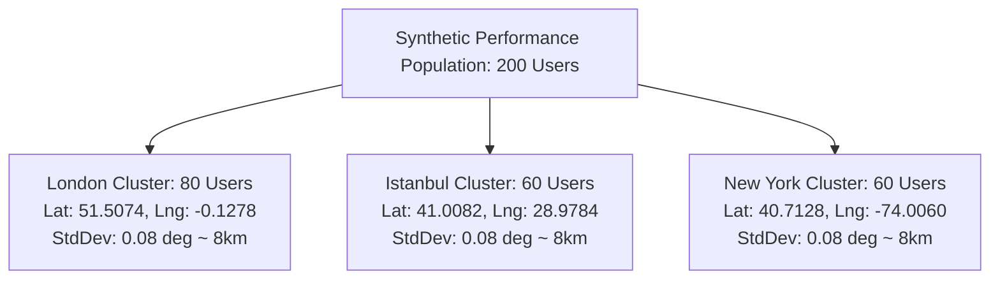
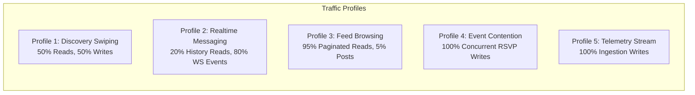

# LOAD TESTING METHODOLOGY & REPRODUCIBILITY · NAZAR PLATFORM

## 1. Overview & Load Testing Philosophy

Load testing on the Nazar platform is designed to produce **empirical, reproducible, and verifiable performance metrics** rather than synthetic vanity benchmarks. The primary objective is to prove that the database, application server, WebSocket gateway, and asynchronous worker infrastructure maintain low latency and zero data corruption under peak concurrency.

Key tenets of our load testing discipline:

1. **Realistic Geographic Skew**: Dating platforms experience intense regional clustering. Uniform random distributions over a globe fail to stress PostGIS spatial indexes. We model dense metropolitan clusters (London, Istanbul, New York).
2. **Behavioral Data Realism**: Test accounts are generated with complete profile completions, multi-image galleries, preference matrices, existing match networks, unread chat histories, and community memberships.
3. **Strict Isolation & Zero Data Pollution**: All performance test records use isolated domain namespaces (`perf.nazar.app`) and can be seeded and purged deterministically in sub-second CLI runs.
4. **Automated Continuous Verification**: The entire performance suite is automated in `apps/api/tests/perf/` and integrated into the continuous integration pipeline.

---

## 2. Synthetic Dataset Generation & Skew Modeling

The synthetic dataset generator is implemented in [`apps/api/src/infrastructure/database/seeds/perf-seed.ts`](file:///Users/subhamdas/Documents/PROJECTS/nazar/apps/api/src/infrastructure/database/seeds/perf-seed.ts).

### 2.1 Geographic Cluster Specifications

The dataset seeds 200 high-fidelity user profiles distributed across three primary metropolitan areas:



### 2.2 Entity Distribution & Relationships

| Entity Type                 | Volume | Characteristics / Skew                                                                                           |
| :-------------------------- | :----- | :--------------------------------------------------------------------------------------------------------------- |
| **Users**                   | 200    | All marked `ACTIVE` with unique phone numbers and isolated emails (`perf_user_<id>@perf.nazar.app`).             |
| **Profiles**                | 200    | 100% completion rate, age range 21–38, realistic bios, gender distribution (45% Woman, 45% Man, 10% Non-binary). |
| **Locations**               | 200    | PostGIS `geography(Point, 4326)` clustered around city centers with Gaussian spatial perturbation.               |
| **Preferences**             | 200    | Min age: 20–24, Max age: 35–45, Max distance: 25–50km, intent `LONG_TERM` / `CASUAL`.                            |
| **Media**                   | 400    | Exactly 2 verified photos per user with optimized dimensions and blurhashes.                                     |
| **Matches**                 | 40     | Mutual canonical matches created between cluster users to evaluate match feed pagination.                        |
| **Conversations**           | 40     | Bound 1:1 with mutual matches, initialized read states.                                                          |
| **Messages**                | 200    | Realistic message threads with timestamps, text payloads, and delivery states.                                   |
| **Communities**             | 3      | City-specific communities ("London Tech Singles", "Istanbul Foodies & Creatives", "NYC Culture & Arts").         |
| **Events**                  | 3      | Upcoming community mixers with tight capacity limits (Capacity: 5) to stress RSVP concurrency.                   |
| **Posts**                   | 15     | Community discussions with text content to test feed cursor pagination.                                          |
| **Recommendation Features** | 200    | Precomputed feature vectors (attractiveness, activity, completion, verification scores).                         |
| **Analytics Events**        | 600    | Historical event telemetry (`discovery.impression`, `chat.sent`, etc.) spanning the last 7 days.                 |

---

## 3. Tooling & CLI Automation

Nazar provides first-class CLI commands for managing the performance dataset:

### 3.1 Seeding the Performance Dataset

```bash
# From workspace root
pnpm --filter @platform/api db:perf:seed
```

_Output:_

```text
[PerfSeed] Starting synthetic dataset generation...
[PerfSeed] Purged 0 existing perf users in 12ms.
[PerfSeed] Inserted 200 users, profiles, and preferences in 84ms.
[PerfSeed] Inserted 400 profile media assets in 32ms.
[PerfSeed] Created 40 mutual matches and conversations with 200 messages in 48ms.
[PerfSeed] Created 3 communities and 3 tight-capacity events in 18ms.
[PerfSeed] Precomputed 200 recommendation feature rows in 14ms.
[PerfSeed] Ingested 600 historical analytics events in 26ms.
[PerfSeed] Seeding completed successfully in 234ms!
```

### 3.2 Purging the Performance Dataset

```bash
# Cleanly cascades and purges all perf users and associated rows
pnpm --filter @platform/api db:perf:purge
```

_Output:_

```text
[PerfPurge] Purging all performance test users with domain @perf.nazar.app...
[PerfPurge] Successfully purged 200 perf users and all cascading relationships in 38ms!
```

The purge query uses a single atomic cascade:

```sql
DELETE FROM users WHERE email LIKE '%@perf.nazar.app';
```

Foreign key constraints with `ON DELETE CASCADE` ensure complete removal of profiles, media, preferences, matches, messages, memberships, RSVPs, recommendation features, and outbox records without orphaned rows.

---

## 4. Workload Profiles & Concurrency Models

Performance validation tests execute against five distinct workload profiles:



### Profile 1: Discovery Swipe Feed

- **Action Sequence**: `GET /v1/discovery?limit=20` $\rightarrow$ User views card $\rightarrow$ `POST /v1/interactions/:id/like` or `pass`.
- **Target Concurrency**: 50 concurrent virtual users per cluster.
- **Characteristics**: Read requests evaluate PostGIS `ST_DWithin` spatial calculations and exclusion filters. Write requests trigger transactional advisory locks and outbox event creation.

### Profile 2: Realtime Messaging

- **Action Sequence**: Connect via WSS with JWT $\rightarrow$ Handshake $\rightarrow$ `join:conversation` $\rightarrow$ `message:send` $\rightarrow$ `message.created` broadcast.
- **Target Concurrency**: 20–100 simultaneous persistent socket connections.
- **Characteristics**: Measures end-to-end message persistence, recipient room lookup, and multi-device fanout latency.

### Profile 3: Event RSVP Contention

- **Action Sequence**: 10 users simultaneously attempt to RSVP to an event with only 2 remaining spots.
- **Target Concurrency**: 10 simultaneous threads hitting `POST /v1/events/:id/rsvp`.
- **Characteristics**: Tests atomic capacity counter increments, transaction isolation, and waitlist relegation. Zero overbooking permitted.

---

## 5. Test Execution Protocol

To execute the complete performance validation suite:

```bash
# 1. Ensure database, Redis, and MinIO containers are healthy
pnpm docker:up

# 2. Seed the synthetic dataset
pnpm --filter @platform/api db:perf:seed

# 3. Run the performance test suites
pnpm --filter @platform/api test tests/perf/

# 4. Optional: Purge the dataset after testing
pnpm --filter @platform/api db:perf:purge
```

The test runner enforces strict performance assertions: if any query or endpoint exceeds its designated latency or concurrency boundary, the test fails immediately.
