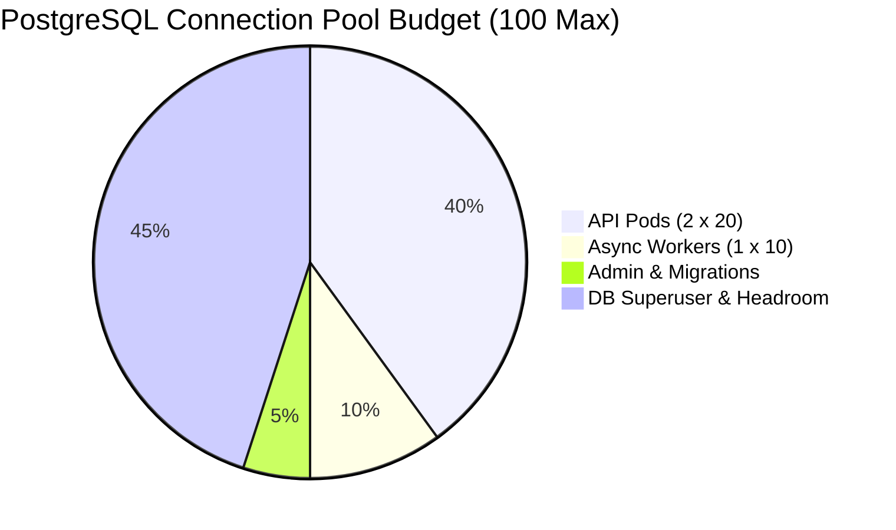
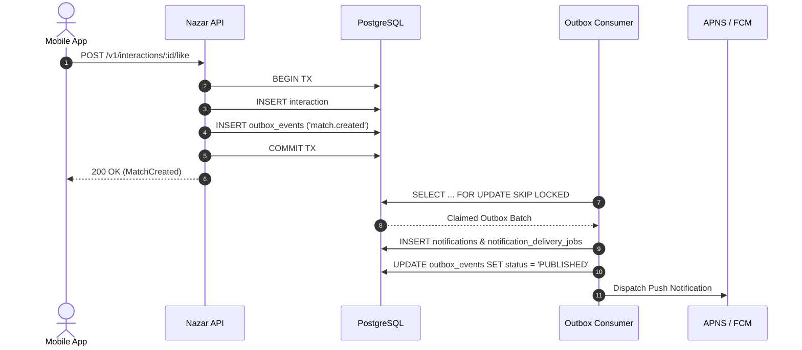

# PERFORMANCE ARCHITECTURE · NAZAR PLATFORM

## 1. Executive Summary & Philosophy

The Nazar performance architecture is engineered around the principle of **predictable latency under realistic concurrency**. Rather than relying on superficial microbenchmarks or premature distributed systems (e.g., Kafka, microservices), Nazar maximizes the performance envelope of a hardened PostgreSQL 16 + PostGIS cluster, an in-memory Redis 7 cache/pubsub layer, and an asynchronous, non-blocking Node.js/NestJS service architecture.

Every architectural layer enforces strict boundaries to eliminate common latency cliffs:

- **Zero N+1 Query Anti-Patterns**: All multi-entity hydrations occur via batched SQL `IN (...)` or array-based parameter queries.
- **Strict Concurrency Control**: Race conditions (such as simultaneous reciprocal likes or token rotations) are serialized at the database engine level using PostgreSQL transactional advisory locks and optimistic concurrency control.
- **Non-Blocking Worker Queuing**: Background tasks (outbox event delivery, push notifications, billing sweeps) operate over PostgreSQL queues utilizing `FOR UPDATE SKIP LOCKED` to allow lockless parallel consumption without queue head-of-line blocking.
- **Fail-Open Ephemeral Layers, Durable Transactional Core**: Caching and realtime WebSocket fanout fail gracefully without degrading transactional integrity.

---

## 2. Platform SLOs & Latency Targets

Nazar defines service level objectives (SLOs) categorized by traffic pattern and business criticality:

| Endpoint Class             | Examples                                 | Target p50 | Target p95 | Target p99 | Target Error Rate |
| :------------------------- | :--------------------------------------- | :--------- | :--------- | :--------- | :---------------- |
| **Health & Edge**          | `GET /v1/health`                         | < 15ms     | < 50ms     | < 100ms    | < 0.01%           |
| **User & Profile Read**    | `GET /v1/profiles/me`                    | < 50ms     | < 120ms    | < 250ms    | < 0.05%           |
| **Spatial Discovery**      | `GET /v1/discovery?limit=20`             | < 60ms     | < 150ms    | < 300ms    | < 0.10%           |
| **Match & Feed Retrieval** | `GET /v1/matches`, `GET /v1/communities` | < 40ms     | < 100ms    | < 200ms    | < 0.05%           |
| **Chat Message History**   | `GET /v1/conversations/:id/messages`     | < 35ms     | < 90ms     | < 180ms    | < 0.05%           |
| **Telemetry Ingestion**    | `POST /v1/analytics/events`              | < 30ms     | < 80ms     | < 150ms    | < 0.01%           |
| **Interactive Writes**     | `POST /v1/interactions/:id/like`         | < 50ms     | < 120ms    | < 250ms    | < 0.05%           |
| **Realtime WS Fanout**     | `message:send` -> `message.created`      | < 30ms     | < 75ms     | < 150ms    | < 0.01%           |

```mermaid
flowchart TD
    Client[Mobile / Web Client] -->|HTTPS / WSS| Ingress[Ingress & TLS Termination]
    Ingress --> API[Nazar NestJS API Gateway]

    subgraph Data Layer
        API -->|Connection Pool (max 20)| PG[(PostgreSQL 16 + PostGIS)]
        API -->|Cache / Sessions / PubSub| Redis[(Redis 7 Cluster)]
    end

    subgraph Async Workers
        Worker1[Outbox Consumer Worker] -->|FOR UPDATE SKIP LOCKED| PG
        Worker2[Push Delivery Worker] -->|Batched Claims| PG
        Worker3[Entitlement Sweep Worker] -->|Scheduled Batch| PG
        Worker2 -->|Push HTTP/2| APNS[Apple APNS / Google FCM]
    end
```

---

## 3. PostgreSQL Connection Pool Budgeting & Sizing

Database connection exhaustion is the primary operational failure mode of Node.js services under high concurrency. Nazar uses `pg-pool` with strict connection budget segregation:

### 3.1 Connection Allocation Formula

The total database connection capacity is derived from:
$$\text{Max DB Connections} \ge (\text{API Pods} \times \text{Pool Size}_{\text{API}}) + (\text{Worker Pods} \times \text{Pool Size}_{\text{Worker}}) + \text{Headroom}$$

For our baseline deployment:

- **PostgreSQL `max_connections`**: 100
- **API Pods (Node.js)**: 2 instances $\times$ pool size 20 = 40 connections
- **Async Workers**: 1 instance $\times$ pool size 10 = 10 connections
- **Administrative & Migrations**: 5 reserved connections
- **PostgreSQL Superuser / Telemetry Headroom**: 45 reserved connections



### 3.2 Connection Lifecycle & Timeout Rules

- **`connectionTimeoutMillis`**: `5,000ms` (fast failure if database is overwhelmed; prevents unbound request queueing).
- **`idleTimeoutMillis`**: `30,000ms` (reclaims idle connections).
- **`statement_timeout`**: Set to `3,000ms` at connection initialization to kill runaway rogue queries before they monopolize worker threads.

---

## 4. Query Patterns & Architectural Rules

To prevent latency regression as tables grow beyond millions of rows, all database interactions adhere to the following rules:

### Rule 1: No Unbounded Scans or Dynamic `OFFSET`

- All paginated endpoints (`/v1/discovery`, `/v1/conversations/:id/messages`, `/v1/social/posts`, `/v1/notifications`) MUST use cursor-based keyset pagination.
- Monotonic sorting keys (`(created_at, id)`) are indexed together (e.g., `idx_messages_conversation_created_id`), enabling constant $O(\log N)$ b-tree lookups regardless of cursor depth.
- `OFFSET` is banned in transactional hot-paths.

### Rule 2: Batched Hydration Over Iterative Queries

- When assembling candidate discovery cards or social feeds, child collections (media URLs, prompt responses, profile preferences) MUST be retrieved via a single batched query:
  ```sql
  SELECT * FROM profile_media WHERE profile_id = ANY($1::uuid[]) ORDER BY "order" ASC;
  ```
- N+1 query loops inside application code are strictly rejected in code review and verified by automated query counter tests.

### Rule 3: PostGIS Spatial Pruning

- Spatial candidate filtering uses PostGIS geometry casting (`ST_DWithin(location, ST_SetSRID(ST_MakePoint(lng, lat), 4326)::geography, max_distance_meters)`).
- All spatial lookups are backed by a GIST spatial index (`idx_profiles_location`).
- The spatial filter is evaluated in conjunction with candidate exclusion sets (blocked users, already swiped users, age boundaries) to prevent expensive spatial scans over ineligible entities.

---

## 5. Concurrency & Isolation Strategy

High-concurrency dating and social platforms encounter extreme contention around:

1. **Reciprocal Swipes**: Users A and B swiping right on each other at the exact same millisecond.
2. **Session Token Rotations**: Mobile clients sending concurrent network requests during token expiration.
3. **Limited Capacity Events**: RSVPs hitting event capacity ceilings simultaneously.

### 5.1 Reciprocal Like Advisory Locks

In standard PostgreSQL `READ COMMITTED` isolation, two concurrent transactions checking `SELECT id FROM interactions WHERE user_id = B AND target_user_id = A` will see zero rows if neither has committed. Both proceed to create a like, and both attempt to create a mutual match, causing duplicate matches or deadlocks.

Nazar resolves this with **deterministic transactional advisory locking**:

```sql
-- User IDs are sorted lexicographically to prevent deadlocks
SELECT pg_advisory_xact_lock(hashtext('match:' || LEAST(userA, userB) || ':' || GREATEST(userA, userB)));
```

- The lock is scoped strictly to the current database transaction (`xact_lock`) and automatically released at `COMMIT` or `ROLLBACK`.
- Contending transactions serialize cleanly without application-level distributed locks.

### 5.2 Optimistic Concurrency for Refresh Tokens

Refresh token rotation validates and updates the session row atomically:

```sql
UPDATE sessions
SET token_hash = $newHash, updated_at = NOW()
WHERE id = $sessionId AND token_hash = $expectedOldHash
RETURNING id;
```

If zero rows are updated, the server detects a concurrent token replay attempt and returns `401 TOKEN_REPLAY_DETECTED`, preventing split-brain session states.

---

## 6. Worker & Asynchronous Architecture

Background tasks are decoupled from interactive API endpoints via the PostgreSQL Outbox pattern:



- **Lockless Consumption**: Workers query `outbox_events` and `notification_delivery_jobs` with `ORDER BY available_at ASC LIMIT 25 FOR UPDATE SKIP LOCKED`.
- **Zero Inter-Worker Contention**: Multiple worker processes claim distinct non-overlapping slices of work simultaneously without blocking or waiting on locked rows.
- **Self-Healing Stuck Job Recovery**: Jobs claimed by a crashed worker instance are automatically transitioned back to `PENDING` after a 5-minute timeout.

---

## 7. Caching & Memory Architecture

Redis 7 operates as an ephemeral acceleration layer:

- **Session Caching**: User session tokens and authorization principals are cached with a 15-minute TTL.
- **Discovery Deduplication**: User swipe exclusion sets (recently swiped IDs) are maintained in Redis Sets with 24-hour TTL to bypass heavy PostgreSQL exclusion scans during high-frequency swiping.
- **WebSocket PubSub Adapter**: Multi-node WebSocket instances synchronize room broadcasts across Redis channels.
- **Failure Resilience**: If Redis becomes unavailable, the API falls back directly to PostgreSQL without dropping requests or violating security constraints.
