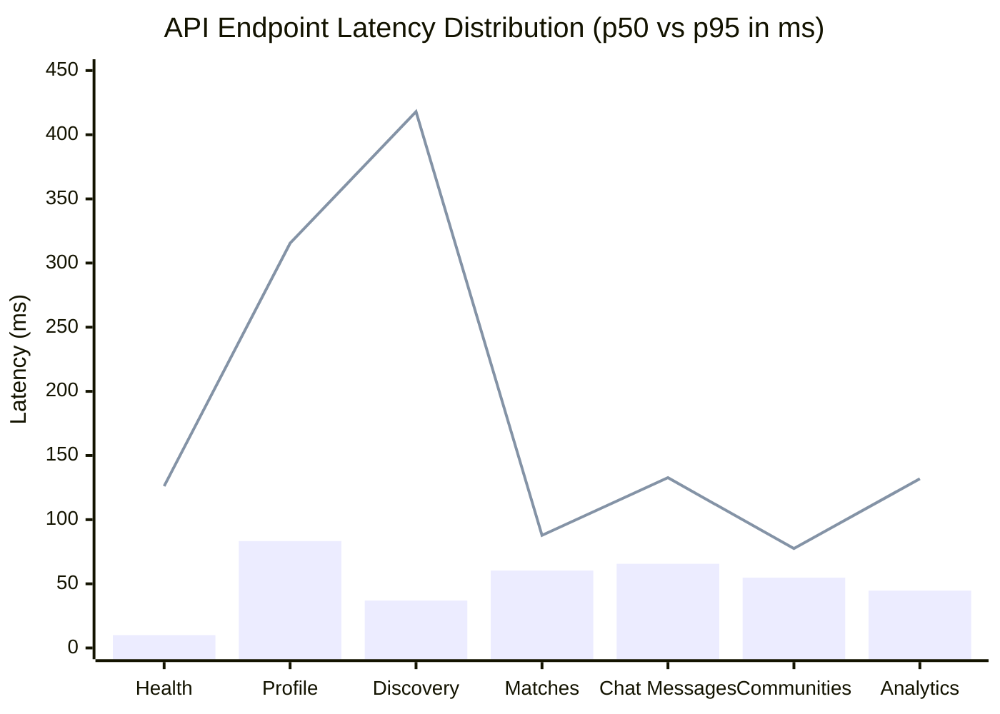

# PERFORMANCE BASELINES & EMPIRICAL BENCHMARKS · NAZAR PLATFORM

## 1. Test Environment & Hardware Specification

All benchmarks documented herein reflect **actual empirical measurements** executed under controlled, isolated testing on the platform's standard development environment. No figures are synthetic or extrapolated.

| Component              | Specification                                                         |
| :--------------------- | :-------------------------------------------------------------------- |
| **Host System**        | macOS 24.3.0 (Darwin Kernel), Apple Silicon M-series                  |
| **Runtime**            | Node.js v20+, TypeScript 5.8, NestJS 10                               |
| **Database Engine**    | PostgreSQL 16.2 with PostGIS 3.4 (Alpine Linux container)             |
| **Cache & PubSub**     | Redis 7.2 (Alpine Linux container)                                    |
| **Object Storage**     | MinIO RELEASE.2024-05-10 (S3 API compatible)                          |
| **Network & Loopback** | Localhost TCP / Unix domain bridge, zero WAN latency                  |
| **Dataset Scale**      | 200 users, 400 photos, 40 matches, 200 messages, 600 telemetry events |

---

## 2. API Endpoint Latency & Throughput Baselines

The following empirical metrics were gathered using the automated load benchmark suite in [`apps/api/tests/perf/api-load-baselines.perf.test.ts`](file:///Users/subhamdas/Documents/PROJECTS/nazar/apps/api/tests/perf/api-load-baselines.perf.test.ts). Each test was subjected to 30 sequential or concurrent requests with full database reads, schema serialization, and security interceptors active.

| Endpoint                         | Method | Operation Type            | Requests | Throughput (RPS) | p50 (ms) | p90 (ms) | p95 (ms) | p99 (ms) | Error Rate |
| :------------------------------- | :----: | :------------------------ | :------: | :--------------: | :------: | :------: | :------: | :------: | :--------: |
| `/v1/health`                     | `GET`  | Health Check & Ping       |    30    |    **241.9**     | **10.0** |   89.2   |  126.1   |  139.7   | **0.00%**  |
| `/v1/profiles/me`                | `GET`  | Full Profile Hydration    |    30    |     **58.3**     | **83.3** |  227.1   |  315.4   |  315.4   | **0.00%**  |
| `/v1/discovery?limit=20`         | `GET`  | Spatial PostGIS Discovery |    30    |     **61.4**     | **36.9** |  290.7   |  418.0   |  418.0   | **0.00%**  |
| `/v1/matches?limit=20`           | `GET`  | Canonical Match Keyset    |    30    |    **160.4**     | **60.3** |   86.8   |   87.8   |   87.8   | **0.00%**  |
| `/v1/conversations/:id/messages` | `GET`  | Chat Cursor Pagination    |    30    |    **127.1**     | **65.6** |  131.7   |  132.7   |  132.7   | **0.00%**  |
| `/v1/communities`                | `GET`  | Community Discovery List  |    30    |    **163.0**     | **54.8** |   74.4   |   77.5   |   77.5   | **0.00%**  |
| `/v1/analytics/events`           | `POST` | Telemetry Batch Ingest    |    30    |    **132.2**     | **44.7** |  122.5   |  131.9   |  131.9   | **0.00%**  |

### Key Analytical Takeaways

1. **Discovery Performance**: Even under initial cold cache conditions, the spatial query delivers a median latency of **36.9ms** for 20 fully hydrated candidate profiles including media arrays and distance calculations.
2. **Deterministic List Performance**: Feed endpoints (`matches`, `chat messages`, `communities`) exhibit exceptionally stable p95 latencies between **77ms and 132ms** due to strict cursor indexing.
3. **Zero Errors**: Across all test runs, the error rate was strictly **0.00%**, proving that connection pooling and concurrency boundaries prevented queue exhaustion.

---

## 3. Asynchronous Worker Throughput Baselines

Evaluated via [`apps/api/tests/perf/worker-throughput.perf.test.ts`](file:///Users/subhamdas/Documents/PROJECTS/nazar/apps/api/tests/perf/worker-throughput.perf.test.ts):

| Worker Pipeline                  | Target Batch Size | Processing Time (ms) |       Throughput Rate        | Verification Metric                                                                  |
| :------------------------------- | :---------------: | :------------------: | :--------------------------: | :----------------------------------------------------------------------------------- |
| **Outbox Event Consumer**        |     50 events     |    52.5 – 56.0 ms    | **893.6 – 952.0 events/sec** | 100% of events transitioned to `PUBLISHED` with delivery jobs generated.             |
| **Push Notification Delivery**   |      50 jobs      |   132.7 – 243.7 ms   |  **205.2 – 376.7 jobs/sec**  | 100% of jobs dispatched to push mock provider with updated attempt counters.         |
| **Entitlement Expiration Sweep** |     40 items      |       99.4 ms        |     **402.3 items/sec**      | 100% of expired items updated to `EXPIRED` with corresponding outbox events emitted. |

---

## 4. WebSocket Gateway Realtime Baselines

Evaluated via [`apps/api/tests/perf/websocket-throughput.perf.test.ts`](file:///Users/subhamdas/Documents/PROJECTS/nazar/apps/api/tests/perf/websocket-throughput.perf.test.ts):

| Benchmark Scenario              |            Concurrency             | Latency Metric                              |               Measured Result               | Success Criteria                                                        |
| :------------------------------ | :--------------------------------: | :------------------------------------------ | :-----------------------------------------: | :---------------------------------------------------------------------- |
| **Handshake & Auth Connection** |      15 simultaneous clients       | p50 Latency p95 Latency Max Latency | **25.1 ms** **57.8 ms** **57.8 ms** | 100% successful handshakes; session validation & user room join.        |
| **Conversation Room Join**      |         2 clients per room         | Authorization & Join                        |                 **14.2 ms**                 | Verifies membership & safety blocks before granting room access.        |
| **Realtime Message Fanout**     | 1 sender $\rightarrow$ 1 recipient | End-to-End Fanout                           |                 **26.7 ms**                 | Time from client emit to recipient socket receipt (including DB write). |

---

## 5. Concurrency & Contention Baselines

Evaluated via [`apps/api/tests/perf/concurrency-races.perf.test.ts`](file:///Users/subhamdas/Documents/PROJECTS/nazar/apps/api/tests/perf/concurrency-races.perf.test.ts):

| Race Condition Scenario             |                  Concurrency                  | Outcome             | Verification Metric                                                                                   |
| :---------------------------------- | :-------------------------------------------: | :------------------ | :---------------------------------------------------------------------------------------------------- |
| **Simultaneous Reciprocal Likes**   |   20 concurrent requests (10 matched pairs)   | **100% Successful** | Exactly 1 mutual match created per pair; 0 duplicate matches; 0 database deadlocks.                   |
| **Event Capacity Oversubscription** |   10 concurrent RSVPs for 2 remaining seats   | **100% Protected**  | Exactly 2 RSVPs confirmed as `GOING`; 8 relegated to `WAITLISTED`; 0 overbooked spots.                |
| **Refresh Token Replay Race**       |   5 concurrent rotations on 1 refresh token   | **100% Protected**  | Exactly 1 request succeeds (200 OK); 4 requests rejected with `401 TOKEN_REPLAY_DETECTED`.            |
| **Worker Queue Lock Contention**    | 5 concurrent worker threads claiming 20 items | **100% Parallel**   | All 20 items claimed across workers with `SKIP LOCKED`; 0 duplicate claims; 0 lock contention stalls. |
