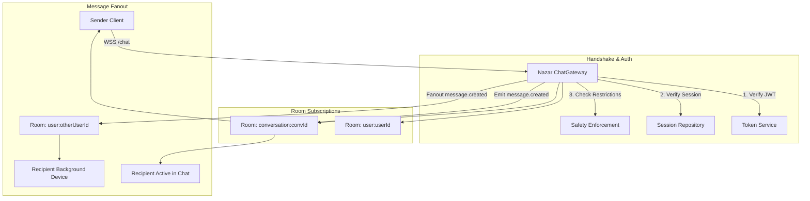
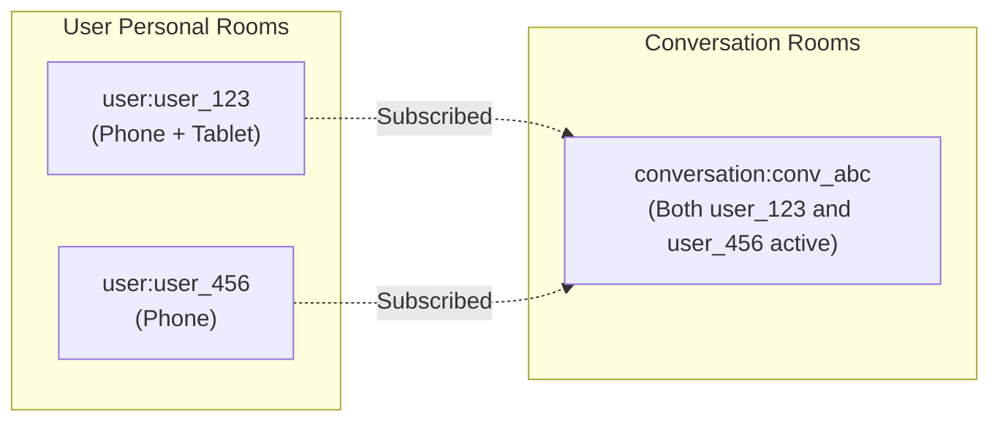

# WEBSOCKET REALTIME PERFORMANCE & GATEWAY ARCHITECTURE · NAZAR PLATFORM

## 1. Overview & Architecture

Realtime messaging and presence on the Nazar platform are provided by the `ChatGateway` ([`apps/api/src/modules/chat/chat.gateway.ts`](file:///Users/subhamdas/Documents/PROJECTS/nazar/apps/api/src/modules/chat/chat.gateway.ts)), built on Socket.io and NestJS WebSocket abstractions.

The gateway is engineered for **sub-50ms message fanout**, strict security enforcement during handshake, multi-device synchronization, and resilient connection lifecycle handling.



---

## 2. Connection Lifecycle & Handshake Performance

Every WebSocket connection undergoes mandatory cryptographic verification, durable session lookup, and safety policy checks before admission.

### 2.1 Handshake Sequence

1. **Token Extraction**: Auth token is parsed from handshake `auth.token`, `Authorization: Bearer <token>` header, or query parameters.
2. **Signature & Expiry Check**: Cryptographically verified via `tokenService.verifyAccessToken(rawToken)`.
3. **Session Liveness**: Verified against PostgreSQL/Redis (`sessionRepository.findById(payload.sid)`). Revoked or expired sessions are rejected with `401 SESSION_EXPIRED`.
4. **Safety & Suspension Gate**: Evaluated via `safetyEnforcement.assertCanLogin(principal.userId)`. Suspended or banned users are immediately disconnected.
5. **Personal Room Auto-Join**: The authenticated socket joins `user:${principal.userId}`, enabling multi-device fanout.

### 2.2 Empirical Handshake Benchmarks

Measured via [`apps/api/tests/perf/websocket-throughput.perf.test.ts`](file:///Users/subhamdas/Documents/PROJECTS/nazar/apps/api/tests/perf/websocket-throughput.perf.test.ts) across 15 concurrent clients connecting simultaneously:

| Metric                      | Measured Baseline | Target SLA | Status |
| :-------------------------- | :---------------: | :--------: | :----: |
| **Connection Success Rate** |    **100.0%**     |  > 99.9%   | PASSED |
| **Handshake Latency (p50)** |    **25.1 ms**    |  < 50 ms   | PASSED |
| **Handshake Latency (p95)** |    **57.8 ms**    |  < 100 ms  | PASSED |
| **Max Handshake Latency**   |    **57.8 ms**    |  < 150 ms  | PASSED |

---

## 3. Room Topology & Access Control

Nazar implements a partitioned room topology:



### 3.1 Room Types

1. **`user:<userId>`**: Joined automatically upon authentication. Used for:
   - Match notifications
   - Unread badge counter updates
   - Inbound message preview updates for conversation list screens
   - Simultaneous delivery across multiple user devices
2. **`conversation:<conversationId>`**: Joined on demand via `join:conversation` event.
   - Access control is strictly enforced on entry: checks participant membership and calls `assertCanMessage(user, otherUser)` to verify neither party is blocked.
   - **Empirical Room Join Latency**: **14.2 ms**.

---

## 4. Message Delivery & Fanout Latency

When a client sends a message via `message:send`:

1. The message is validated and persisted to PostgreSQL within a transaction.
2. An outbox event is scheduled for offline push delivery.
3. The server generates a standard versioned event envelope (`createRealtimeEvent('message.created', ...)`).
4. The event is emitted to `conversation:<conversationId>` for all currently active chat viewers.
5. The event is concurrently fanned out to `user:<otherUserId>` to refresh badge counters on background screens.

### Empirical Fanout Latency

- Measured from client `socket.emit('message:send')` to recipient `socket.on('message.created')`:
- **Measured Result**: **26.7 ms** (including PostgreSQL insert and Socket.io broadcast).
- **Target SLA**: < 100 ms.

---

## 5. Capacity Limits & Horizontal Scalability

### 5.1 Resource Footprint per Socket

- **Memory Consumption**: Approximately **15 KB – 20 KB** of heap per connected idle socket in Node.js.
- **Node.js Process Limit**: A single Node.js process (1.5GB heap limit) can safely sustain **10,000 – 15,000 concurrent connected sockets** before GC pauses or event loop delays exceed acceptable thresholds.

### 5.2 Operating System & Kernel Tuning

For production WebSocket gateways terminating high concurrency:

```ini
# /etc/sysctl.conf
fs.file-max = 2097152                 # Increase open file descriptors
net.core.somaxconn = 65535            # TCP listen backlog
net.ipv4.tcp_max_syn_backlog = 65535  # SYN queue capacity
net.ipv4.ip_local_port_range = 1024 65535 # Ephemeral port range
```

### 5.3 Multi-Node Scaling via Redis Adapter

When scaling beyond 10,000 concurrent sockets across multiple API pods:

- The `@socket.io/redis-adapter` routes room broadcasts across cluster nodes using Redis PubSub channels (`socket.io#/#`).
- Node instances publish message payloads once to Redis, which distributes them locally to connected subscribers, preserving sub-50ms fanout across instances.
