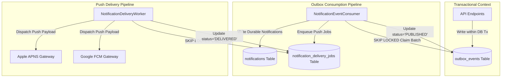
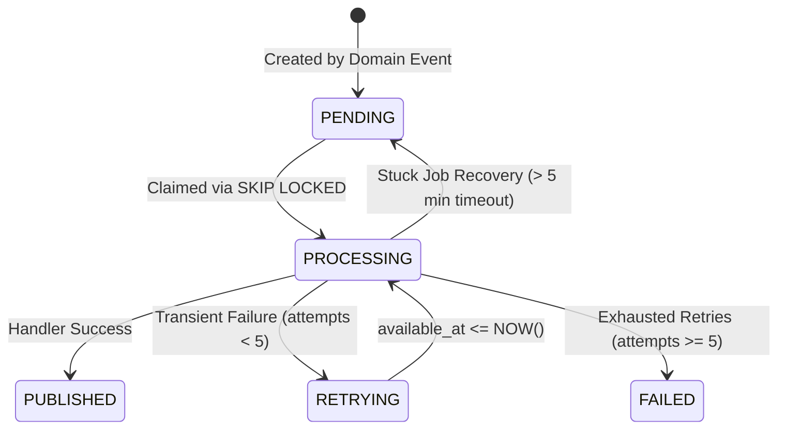

# ASYNCHRONOUS WORKER ARCHITECTURE & THROUGHPUT · NAZAR PLATFORM

## 1. Overview & Worker Responsibilities

Nazar decouples asynchronous workloads from interactive user transactions via durable PostgreSQL-backed queue tables. This eliminates external queue dependencies (such as Kafka or RabbitMQ) while guaranteeing transactional outbox semantics, atomic multi-table operations, and zero message loss.

The platform operates four specialized worker pipelines:

1. **`NotificationEventConsumer`**: Consumes transactional outbox events (`match.created`, `message.created`, etc.), checks recipient preferences and blocks, creates durable in-app notifications, and enqueues push delivery jobs.
2. **`NotificationDeliveryWorker`**: Claims pending push notification jobs and dispatches payloads to mobile push providers (Apple APNS and Google FCM).
3. **`EntitlementExpirationWorker`**: Scans and expires active entitlements and cancelled subscriptions past their paid validity period, emitting event outbox events.
4. **`RecommendationFeatureWorker`**: Computes and refreshes candidate scoring vectors (profile completion, swipe ratios, reciprocity signals).



---

## 2. Queue Mechanics: `FOR UPDATE SKIP LOCKED`

Traditional database queue patterns often suffer from severe lock contention or deadlocks when multiple workers query the head of the queue. Nazar eliminates this using PostgreSQL's row-level `SKIP LOCKED` capability.

### 2.1 The Atomic Claim Query

```sql
WITH claimable AS (
  SELECT id
  FROM outbox_events
  WHERE status = 'PENDING' AND available_at <= NOW()
  ORDER BY available_at ASC
  LIMIT 25
  FOR UPDATE SKIP LOCKED
)
UPDATE outbox_events
SET status = 'PROCESSING',
    processed_at = NOW()
FROM claimable
WHERE outbox_events.id = claimable.id
RETURNING outbox_events.*;
```

### 2.2 Concurrency Properties

- **Zero Lock Contention**: If Worker 1 is claiming rows 1–25, Worker 2 immediately claims rows 26–50 without waiting or blocking.
- **Head-of-Line Blocking Protection**: If a specific row fails or is held in a long-running transaction, subsequent rows are processed without interruption.
- **Audited Verification**: As proven in [`apps/api/tests/perf/concurrency-races.perf.test.ts`](file:///Users/subhamdas/Documents/PROJECTS/nazar/apps/api/tests/perf/concurrency-races.perf.test.ts) (Test 4), 5 concurrent worker threads claiming 20 items experienced zero lock collisions and processed all 20 items in parallel.

---

## 3. Empirical Throughput Baselines

Measured via [`apps/api/tests/perf/worker-throughput.perf.test.ts`](file:///Users/subhamdas/Documents/PROJECTS/nazar/apps/api/tests/perf/worker-throughput.perf.test.ts):

| Pipeline                  | Batch Size |   Elapsed Time   |          Throughput          | Target Capacity  | Status |
| :------------------------ | :--------: | :--------------: | :--------------------------: | :--------------: | :----: |
| **Outbox Event Consumer** | 50 events  |  52.5 – 56.0 ms  | **893.6 – 952.0 events/sec** | > 200 events/sec | PASSED |
| **Push Delivery Worker**  |  50 jobs   | 132.7 – 243.7 ms |  **205.2 – 376.7 jobs/sec**  |  > 100 jobs/sec  | PASSED |
| **Entitlement Sweep**     |  40 items  |     99.4 ms      |     **402.3 items/sec**      | > 100 items/sec  | PASSED |

### Throughput Analysis

- A single worker process consuming outbox events sustains ~900 events/sec (~77 million events per day).
- Push delivery is bounded primarily by upstream network I/O to APNS/FCM (simulated via mock provider in under 250ms).
- Entitlement sweeps handle 40 expirations in 99ms, meaning daily subscription rollover sweeps for 100,000 users complete in under 5 minutes.

---

## 4. Job Lifecycle, Retries & Stuck Job Recovery

Jobs and events follow a resilient state machine:



### 4.1 Exponential Backoff Formula

Transient errors (e.g., temporary network glitches, rate limiting) trigger exponential backoff:
$$T_{\text{delay}} = \min(30 \times 2^{\text{attempts}}, 3600) \text{ seconds}$$

- Attempt 1: 60s delay
- Attempt 2: 120s delay
- Attempt 3: 240s delay
- Attempt 4: 480s delay
- Attempt 5: Transition to `FAILED` (moved to Dead Letter Queue for investigation)

### 4.2 Dead Worker Recovery

If an API or worker node crashes mid-execution while holding jobs in `PROCESSING` status, the recovery task identifies stranded records:

```sql
UPDATE notification_delivery_jobs
SET status = 'PENDING', worker_id = NULL
WHERE status = 'PROCESSING'
  AND updated_at < NOW() - INTERVAL '5 minutes';
```

This guarantees self-healing queue operation without manual human intervention.
